## Net Profit [📉]:
### $-5968.00
|type|graph|data|
|:---:|:---:|:---:|
|30m / 1d|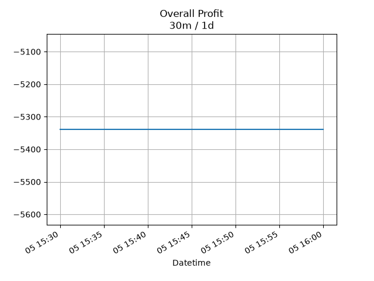|<table border="1" class="dataframe"> <thead> <tr style="text-align: center;"> <th>Datetime</th> <th>profit</th> </tr> </thead> <tbody> <tr> <td>09:30</td> <td>NaN</td> </tr> <tr> <td>10:00</td> <td>NaN</td> </tr> <tr> <td>10:30</td> <td>NaN</td> </tr> <tr> <td>11:00</td> <td>NaN</td> </tr> <tr> <td>11:30</td> <td>NaN</td> </tr> <tr> <td>13:00</td> <td>NaN</td> </tr> <tr> <td>13:30</td> <td>NaN</td> </tr> <tr> <td>14:00</td> <td>NaN</td> </tr> <tr> <td>14:30</td> <td>NaN</td> </tr> <tr> <td>15:00</td> <td>NaN</td> </tr> <tr> <td>15:30</td> <td>NaN</td> </tr> <tr> <td>16:00</td> <td>NaN</td> </tr> </tbody></table>|
|1d / 5d|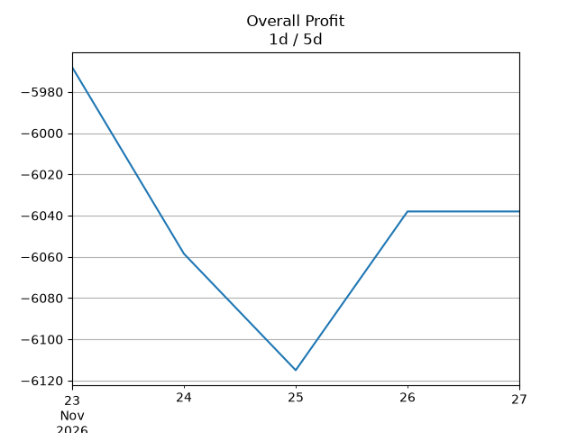|<table border="1" class="dataframe"> <thead> <tr style="text-align: center;"> <th>Date</th> <th>profit</th> </tr> </thead> <tbody> <tr> <td>2026-11-17</td> <td>-5701.0</td> </tr> <tr> <td>2026-11-18</td> <td>-5692.5</td> </tr> <tr> <td>2026-11-19</td> <td>-5842.5</td> </tr> <tr> <td>2026-11-20</td> <td>-5916.0</td> </tr> <tr> <td>2026-11-23</td> <td>-5968.0</td> </tr> </tbody></table>|
|1wk / 1mo|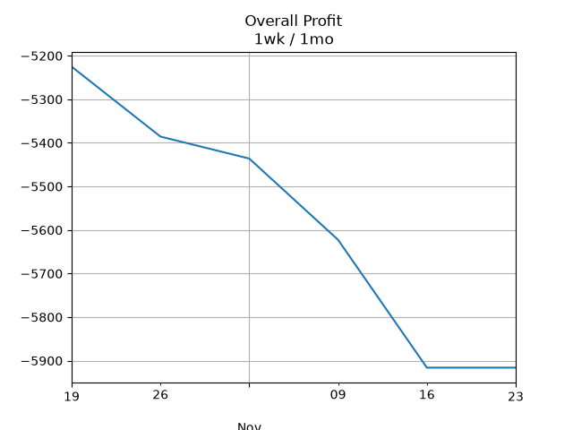|<table border="1" class="dataframe"> <thead> <tr style="text-align: center;"> <th>Date</th> <th>profit</th> </tr> </thead> <tbody> <tr> <td>2026-10-19</td> <td>-5225.0</td> </tr> <tr> <td>2026-10-26</td> <td>-5385.5</td> </tr> <tr> <td>2026-11-02</td> <td>-5436.0</td> </tr> <tr> <td>2026-11-09</td> <td>-5622.5</td> </tr> <tr> <td>2026-11-16</td> <td>-5916.0</td> </tr> <tr> <td>2026-11-23</td> <td>-5916.0</td> </tr> </tbody></table>|
---
## 0573.HK [📉] [$-792.00] [-42.31%]:
#### Tao Heung Holdings Limited
|price|profit|data|
|:---:|:---:|:---:|
|||<table border="1" class="dataframe"> <thead> <tr style="text-align: center;"> <th>Datetime</th> <th>profit</th> </tr> </thead> <tbody> <tr> <td>09:30</td> <td>-872.0</td> </tr> <tr> <td>10:30</td> <td>-852.0</td> </tr> <tr> <td>14:00</td> <td>-792.0</td> </tr> <tr> <td>14:30</td> <td>-792.0</td> </tr> </tbody></table>|
|||<table border="1" class="dataframe"> <thead> <tr style="text-align: center;"> <th>Date</th> <th>profit</th> </tr> </thead> <tbody> <tr> <td>2026-11-17</td> <td>-872.0</td> </tr> <tr> <td>2026-11-18</td> <td>-852.0</td> </tr> <tr> <td>2026-11-19</td> <td>-852.0</td> </tr> <tr> <td>2026-11-20</td> <td>-852.0</td> </tr> <tr> <td>2026-11-23</td> <td>-792.0</td> </tr> </tbody></table>|
|||<table border="1" class="dataframe"> <thead> <tr style="text-align: center;"> <th>Date</th> <th>profit</th> </tr> </thead> <tbody> <tr> <td>2026-10-19</td> <td>-792.0</td> </tr> <tr> <td>2026-10-26</td> <td>-752.0</td> </tr> <tr> <td>2026-11-02</td> <td>-792.0</td> </tr> <tr> <td>2026-11-09</td> <td>-812.0</td> </tr> <tr> <td>2026-11-16</td> <td>-852.0</td> </tr> <tr> <td>2026-11-23</td> <td>-852.0</td> </tr> </tbody></table>|
---
## 0560.HK [📉] [$-936.00] [-29.10%]:
#### Chu Kong Shipping Enterprises (Group) Company Limited
|price|profit|data|
|:---:|:---:|:---:|
|||<table border="1" class="dataframe"> <thead> <tr style="text-align: center;"> <th>Datetime</th> <th>profit</th> </tr> </thead> <tbody> <tr> <td>13:00</td> <td>-996.0</td> </tr> <tr> <td>13:30</td> <td>-976.0</td> </tr> <tr> <td>15:00</td> <td>-996.0</td> </tr> <tr> <td>16:00</td> <td>-936.0</td> </tr> </tbody></table>|
|||<table border="1" class="dataframe"> <thead> <tr style="text-align: center;"> <th>Date</th> <th>profit</th> </tr> </thead> <tbody> <tr> <td>2026-11-17</td> <td>-956.0</td> </tr> <tr> <td>2026-11-18</td> <td>-956.0</td> </tr> <tr> <td>2026-11-19</td> <td>-956.0</td> </tr> <tr> <td>2026-11-20</td> <td>-936.0</td> </tr> <tr> <td>2026-11-23</td> <td>-936.0</td> </tr> </tbody></table>|
|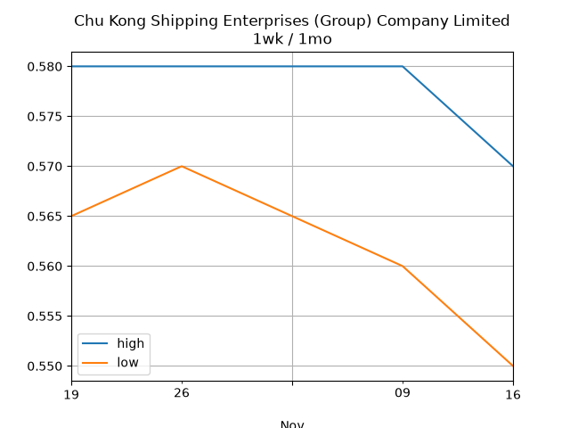||<table border="1" class="dataframe"> <thead> <tr style="text-align: center;"> <th>Date</th> <th>profit</th> </tr> </thead> <tbody> <tr> <td>2026-10-19</td> <td>-956.0</td> </tr> <tr> <td>2026-10-26</td> <td>-896.0</td> </tr> <tr> <td>2026-11-02</td> <td>-936.0</td> </tr> <tr> <td>2026-11-09</td> <td>-936.0</td> </tr> <tr> <td>2026-11-16</td> <td>-936.0</td> </tr> <tr> <td>2026-11-23</td> <td>-936.0</td> </tr> </tbody></table>|
---
## 0709.HK [📉] [$-1846.00] [-44.20%]:
#### Giordano International Limited
|price|profit|data|
|:---:|:---:|:---:|
|||<table border="1" class="dataframe"> <thead> <tr style="text-align: center;"> <th>Datetime</th> <th>profit</th> </tr> </thead> <tbody> <tr> <td>09:30</td> <td>-1896.0</td> </tr> <tr> <td>10:00</td> <td>-1886.0</td> </tr> <tr> <td>10:30</td> <td>-1886.0</td> </tr> <tr> <td>11:00</td> <td>-1886.0</td> </tr> <tr> <td>11:30</td> <td>-1886.0</td> </tr> <tr> <td>13:00</td> <td>-1856.0</td> </tr> <tr> <td>13:30</td> <td>-1856.0</td> </tr> <tr> <td>14:00</td> <td>-1856.0</td> </tr> <tr> <td>14:30</td> <td>-1866.0</td> </tr> <tr> <td>15:00</td> <td>-1846.0</td> </tr> <tr> <td>15:30</td> <td>-1846.0</td> </tr> <tr> <td>16:00</td> <td>-1846.0</td> </tr> </tbody></table>|
|||<table border="1" class="dataframe"> <thead> <tr style="text-align: center;"> <th>Date</th> <th>profit</th> </tr> </thead> <tbody> <tr> <td>2026-11-17</td> <td>-1786.0</td> </tr> <tr> <td>2026-11-18</td> <td>-1796.0</td> </tr> <tr> <td>2026-11-19</td> <td>-1836.0</td> </tr> <tr> <td>2026-11-20</td> <td>-1886.0</td> </tr> <tr> <td>2026-11-23</td> <td>-1846.0</td> </tr> </tbody></table>|
||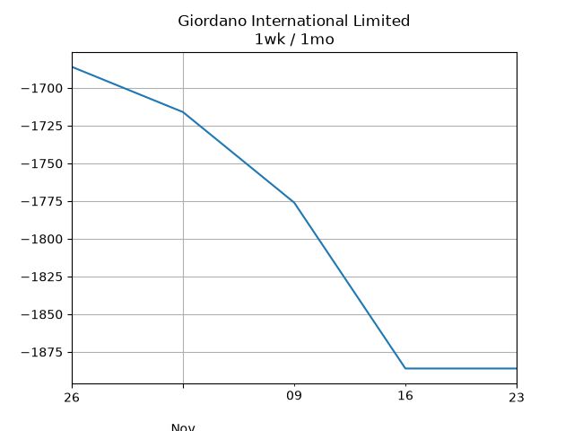|<table border="1" class="dataframe"> <thead> <tr style="text-align: center;"> <th>Date</th> <th>profit</th> </tr> </thead> <tbody> <tr> <td>2026-10-19</td> <td>-1646.0</td> </tr> <tr> <td>2026-10-26</td> <td>-1686.0</td> </tr> <tr> <td>2026-11-02</td> <td>-1716.0</td> </tr> <tr> <td>2026-11-09</td> <td>-1776.0</td> </tr> <tr> <td>2026-11-16</td> <td>-1886.0</td> </tr> <tr> <td>2026-11-23</td> <td>-1886.0</td> </tr> </tbody></table>|
---
## 1310.HK [📉] [$-289.00] [-9.90%]:
#### HKBN Ltd.
|price|profit|data|
|:---:|:---:|:---:|
||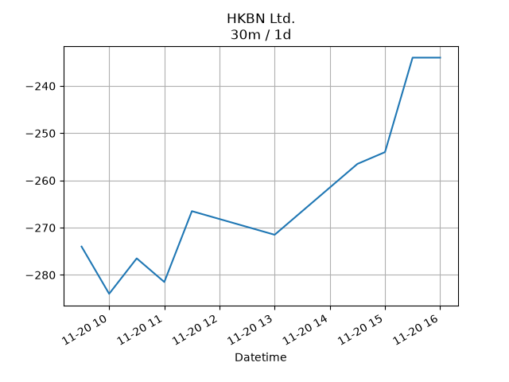|<table border="1" class="dataframe"> <thead> <tr style="text-align: center;"> <th>Datetime</th> <th>profit</th> </tr> </thead> <tbody> <tr> <td>09:30</td> <td>-284.0</td> </tr> <tr> <td>10:00</td> <td>-291.5</td> </tr> <tr> <td>10:30</td> <td>-301.5</td> </tr> <tr> <td>11:00</td> <td>-284.0</td> </tr> <tr> <td>11:30</td> <td>-286.5</td> </tr> <tr> <td>13:00</td> <td>-289.0</td> </tr> <tr> <td>13:30</td> <td>-286.5</td> </tr> <tr> <td>14:00</td> <td>-291.5</td> </tr> <tr> <td>14:30</td> <td>-291.5</td> </tr> <tr> <td>15:00</td> <td>-286.5</td> </tr> <tr> <td>15:30</td> <td>-289.0</td> </tr> <tr> <td>16:00</td> <td>-289.0</td> </tr> </tbody></table>|
|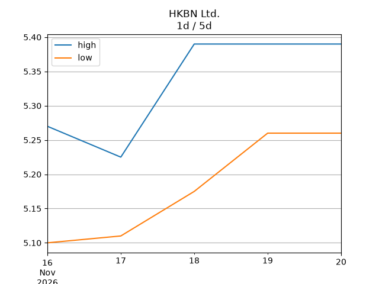|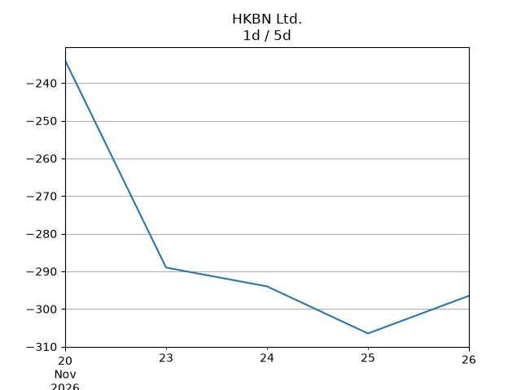|<table border="1" class="dataframe"> <thead> <tr style="text-align: center;"> <th>Date</th> <th>profit</th> </tr> </thead> <tbody> <tr> <td>2026-11-17</td> <td>-339.0</td> </tr> <tr> <td>2026-11-18</td> <td>-256.5</td> </tr> <tr> <td>2026-11-19</td> <td>-261.5</td> </tr> <tr> <td>2026-11-20</td> <td>-234.0</td> </tr> <tr> <td>2026-11-23</td> <td>-289.0</td> </tr> </tbody></table>|
|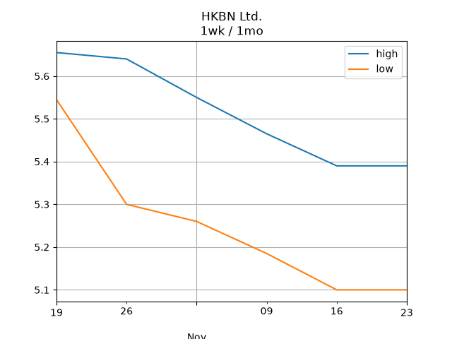||<table border="1" class="dataframe"> <thead> <tr style="text-align: center;"> <th>Date</th> <th>profit</th> </tr> </thead> <tbody> <tr> <td>2026-10-19</td> <td>-116.5</td> </tr> <tr> <td>2026-10-26</td> <td>-261.5</td> </tr> <tr> <td>2026-11-02</td> <td>-206.5</td> </tr> <tr> <td>2026-11-09</td> <td>-321.5</td> </tr> <tr> <td>2026-11-16</td> <td>-234.0</td> </tr> <tr> <td>2026-11-23</td> <td>-234.0</td> </tr> </tbody></table>|
---
## 2638.HK [📈] [$281.00] [9.86%]:
#### HK Electric Investments and HK Electric Investments Limited
|price|profit|data|
|:---:|:---:|:---:|
|||<table border="1" class="dataframe"> <thead> <tr style="text-align: center;"> <th>Datetime</th> <th>profit</th> </tr> </thead> <tbody> <tr> <td>09:30</td> <td>258.5</td> </tr> <tr> <td>10:00</td> <td>278.5</td> </tr> <tr> <td>10:30</td> <td>268.5</td> </tr> <tr> <td>11:00</td> <td>273.5</td> </tr> <tr> <td>11:30</td> <td>276.0</td> </tr> <tr> <td>13:00</td> <td>273.5</td> </tr> <tr> <td>13:30</td> <td>278.5</td> </tr> <tr> <td>14:00</td> <td>276.0</td> </tr> <tr> <td>14:30</td> <td>278.5</td> </tr> <tr> <td>15:00</td> <td>281.0</td> </tr> <tr> <td>15:30</td> <td>278.5</td> </tr> <tr> <td>16:00</td> <td>281.0</td> </tr> </tbody></table>|
|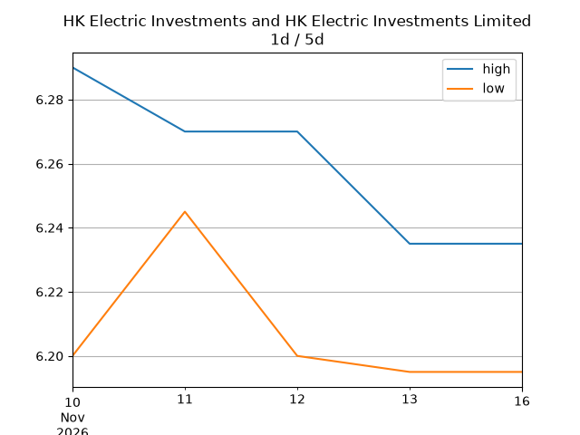||<table border="1" class="dataframe"> <thead> <tr style="text-align: center;"> <th>Date</th> <th>profit</th> </tr> </thead> <tbody> <tr> <td>2026-11-17</td> <td>286.0</td> </tr> <tr> <td>2026-11-18</td> <td>271.0</td> </tr> <tr> <td>2026-11-19</td> <td>286.0</td> </tr> <tr> <td>2026-11-20</td> <td>283.5</td> </tr> <tr> <td>2026-11-23</td> <td>281.0</td> </tr> </tbody></table>|
|||<table border="1" class="dataframe"> <thead> <tr style="text-align: center;"> <th>Date</th> <th>profit</th> </tr> </thead> <tbody> <tr> <td>2026-10-19</td> <td>261.0</td> </tr> <tr> <td>2026-10-26</td> <td>231.0</td> </tr> <tr> <td>2026-11-02</td> <td>253.5</td> </tr> <tr> <td>2026-11-09</td> <td>251.0</td> </tr> <tr> <td>2026-11-16</td> <td>283.5</td> </tr> <tr> <td>2026-11-23</td> <td>283.5</td> </tr> </tbody></table>|
---
## 0533.HK [📉] [$-1875.00] [-47.17%]:
#### Goldlion Holdings Limited
|price|profit|data|
|:---:|:---:|:---:|
|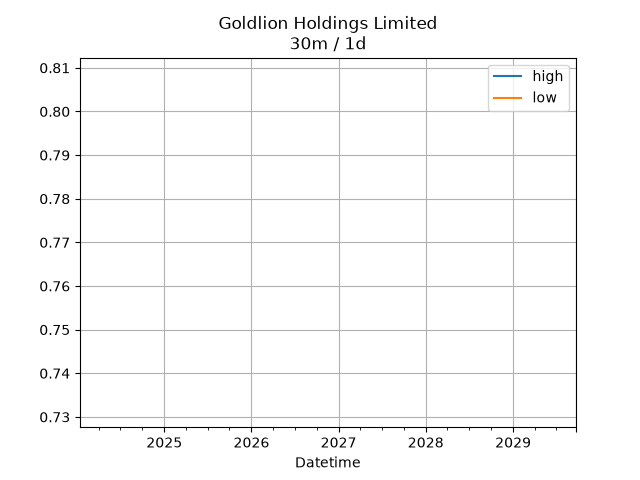||<table border="1" class="dataframe"> <thead> <tr style="text-align: center;"> <th>Datetime</th> <th>profit</th> </tr> </thead> <tbody> <tr> <td>10:00</td> <td>-1860.0</td> </tr> <tr> <td>11:00</td> <td>-1875.0</td> </tr> <tr> <td>13:00</td> <td>-1890.0</td> </tr> <tr> <td>13:30</td> <td>-1875.0</td> </tr> <tr> <td>15:00</td> <td>-1875.0</td> </tr> </tbody></table>|
|||<table border="1" class="dataframe"> <thead> <tr style="text-align: center;"> <th>Date</th> <th>profit</th> </tr> </thead> <tbody> <tr> <td>2026-11-17</td> <td>-1665.0</td> </tr> <tr> <td>2026-11-18</td> <td>-1710.0</td> </tr> <tr> <td>2026-11-19</td> <td>-1785.0</td> </tr> <tr> <td>2026-11-20</td> <td>-1815.0</td> </tr> <tr> <td>2026-11-23</td> <td>-1875.0</td> </tr> </tbody></table>|
|||<table border="1" class="dataframe"> <thead> <tr style="text-align: center;"> <th>Date</th> <th>profit</th> </tr> </thead> <tbody> <tr> <td>2026-10-19</td> <td>-1575.0</td> </tr> <tr> <td>2026-10-26</td> <td>-1620.0</td> </tr> <tr> <td>2026-11-02</td> <td>-1725.0</td> </tr> <tr> <td>2026-11-09</td> <td>-1665.0</td> </tr> <tr> <td>2026-11-16</td> <td>-1815.0</td> </tr> <tr> <td>2026-11-23</td> <td>-1815.0</td> </tr> </tbody></table>|
---
## 2618.HK [📉] [$-511.00] [-36.76%]:
#### JD Logistics, Inc.
|price|profit|data|
|:---:|:---:|:---:|
|||<table border="1" class="dataframe"> <thead> <tr style="text-align: center;"> <th>Datetime</th> <th>profit</th> </tr> </thead> <tbody> <tr> <td>09:30</td> <td>-502.0</td> </tr> <tr> <td>10:00</td> <td>-509.5</td> </tr> <tr> <td>10:30</td> <td>-516.0</td> </tr> <tr> <td>11:00</td> <td>-509.0</td> </tr> <tr> <td>11:30</td> <td>-513.0</td> </tr> <tr> <td>13:00</td> <td>-500.0</td> </tr> <tr> <td>13:30</td> <td>-506.0</td> </tr> <tr> <td>14:00</td> <td>-509.5</td> </tr> <tr> <td>14:30</td> <td>-507.0</td> </tr> <tr> <td>15:00</td> <td>-508.5</td> </tr> <tr> <td>15:30</td> <td>-511.0</td> </tr> <tr> <td>16:00</td> <td>-511.0</td> </tr> </tbody></table>|
|||<table border="1" class="dataframe"> <thead> <tr style="text-align: center;"> <th>Date</th> <th>profit</th> </tr> </thead> <tbody> <tr> <td>2026-11-17</td> <td>-369.0</td> </tr> <tr> <td>2026-11-18</td> <td>-393.0</td> </tr> <tr> <td>2026-11-19</td> <td>-438.0</td> </tr> <tr> <td>2026-11-20</td> <td>-476.5</td> </tr> <tr> <td>2026-11-23</td> <td>-511.0</td> </tr> </tbody></table>|
|||<table border="1" class="dataframe"> <thead> <tr style="text-align: center;"> <th>Date</th> <th>profit</th> </tr> </thead> <tbody> <tr> <td>2026-10-19</td> <td>-400.5</td> </tr> <tr> <td>2026-10-26</td> <td>-401.0</td> </tr> <tr> <td>2026-11-02</td> <td>-314.0</td> </tr> <tr> <td>2026-11-09</td> <td>-363.0</td> </tr> <tr> <td>2026-11-16</td> <td>-476.5</td> </tr> <tr> <td>2026-11-23</td> <td>-476.5</td> </tr> </tbody></table>|
---
