## Net Profit [📉]:
### $-4848.50
|type|graph|data|
|:---:|:---:|:---:|
|30m / 1d|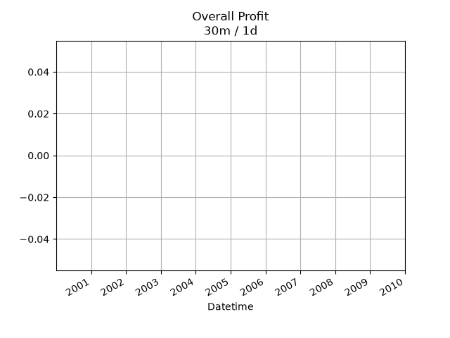|<table border="1" class="dataframe"> <thead> <tr style="text-align: center;"> <th>Datetime</th> <th>profit</th> </tr> </thead> <tbody> <tr> <td>09:30</td> <td>NaN</td> </tr> <tr> <td>10:00</td> <td>NaN</td> </tr> <tr> <td>10:30</td> <td>NaN</td> </tr> <tr> <td>11:00</td> <td>NaN</td> </tr> <tr> <td>11:30</td> <td>NaN</td> </tr> <tr> <td>13:00</td> <td>NaN</td> </tr> <tr> <td>13:30</td> <td>NaN</td> </tr> <tr> <td>14:00</td> <td>NaN</td> </tr> <tr> <td>14:30</td> <td>NaN</td> </tr> <tr> <td>15:00</td> <td>NaN</td> </tr> </tbody></table>|
|1d / 5d|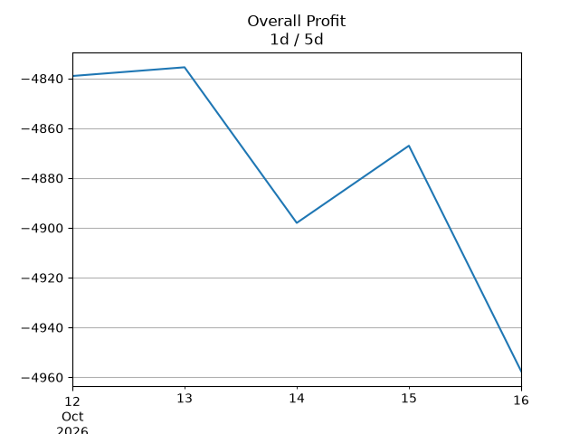|<table border="1" class="dataframe"> <thead> <tr style="text-align: center;"> <th>Date</th> <th>profit</th> </tr> </thead> <tbody> <tr> <td>2026-10-07</td> <td>-4883.0</td> </tr> <tr> <td>2026-10-08</td> <td>-4928.5</td> </tr> <tr> <td>2026-10-09</td> <td>-4821.0</td> </tr> <tr> <td>2026-10-13</td> <td>-4848.5</td> </tr> </tbody></table>|
|1wk / 1mo|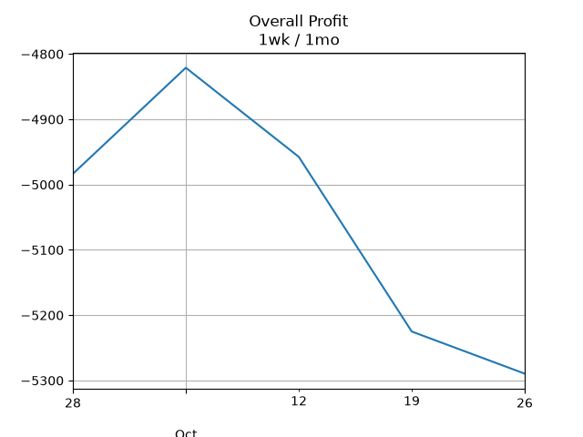|<table border="1" class="dataframe"> <thead> <tr style="text-align: center;"> <th>Date</th> <th>profit</th> </tr> </thead> <tbody> <tr> <td>2026-09-14</td> <td>-4805.0</td> </tr> <tr> <td>2026-09-21</td> <td>-4938.0</td> </tr> <tr> <td>2026-09-28</td> <td>-4983.5</td> </tr> <tr> <td>2026-10-05</td> <td>-4821.0</td> </tr> <tr> <td>2026-10-12</td> <td>-4848.5</td> </tr> </tbody></table>|
---
## 0573.HK [📉] [$-752.00] [-40.17%]:
#### Tao Heung Holdings Limited
|price|profit|data|
|:---:|:---:|:---:|
|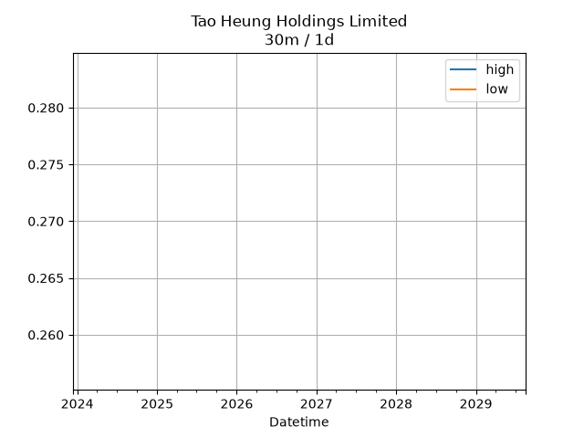|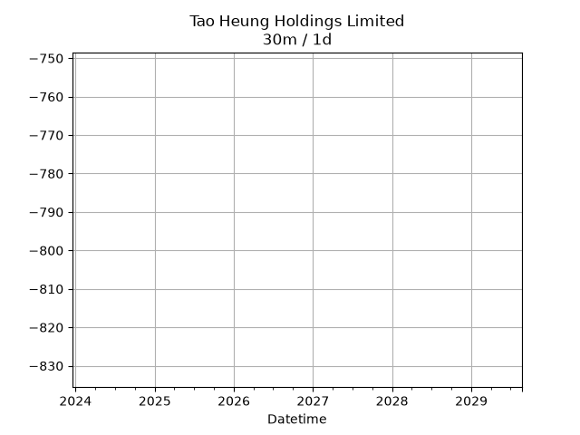|<table border="1" class="dataframe"> <thead> <tr style="text-align: center;"> <th>Datetime</th> <th>profit</th> </tr> </thead> <tbody> <tr> <td>09:30</td> <td>-792.0</td> </tr> <tr> <td>10:30</td> <td>-752.0</td> </tr> <tr> <td>14:30</td> <td>-752.0</td> </tr> </tbody></table>|
|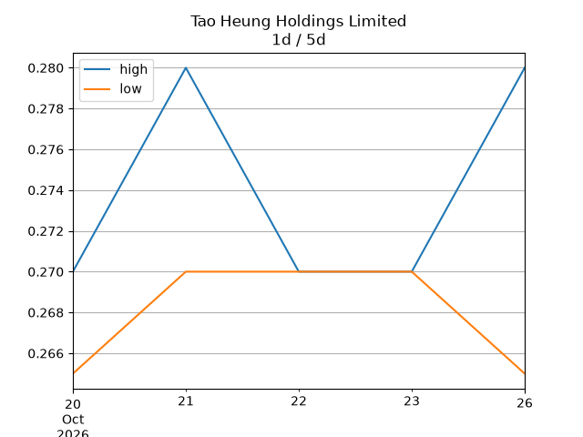|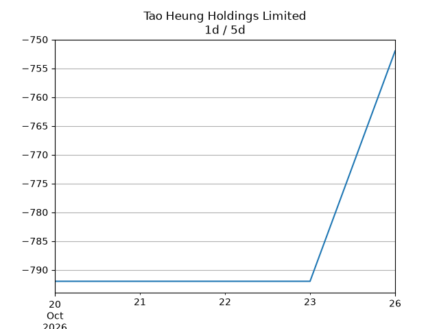|<table border="1" class="dataframe"> <thead> <tr style="text-align: center;"> <th>Date</th> <th>profit</th> </tr> </thead> <tbody> <tr> <td>2026-10-07</td> <td>-752.0</td> </tr> <tr> <td>2026-10-08</td> <td>-772.0</td> </tr> <tr> <td>2026-10-09</td> <td>-752.0</td> </tr> <tr> <td>2026-10-13</td> <td>-752.0</td> </tr> </tbody></table>|
|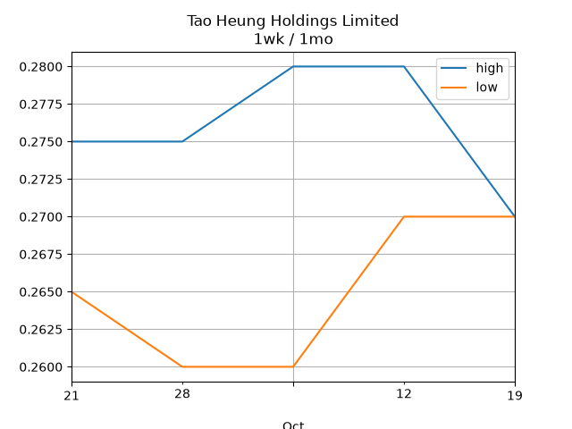|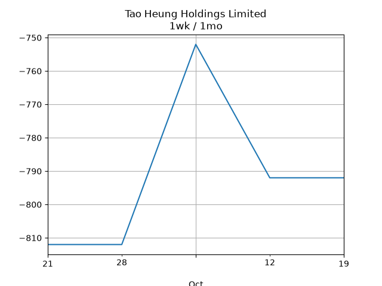|<table border="1" class="dataframe"> <thead> <tr style="text-align: center;"> <th>Date</th> <th>profit</th> </tr> </thead> <tbody> <tr> <td>2026-09-14</td> <td>-772.0</td> </tr> <tr> <td>2026-09-21</td> <td>-812.0</td> </tr> <tr> <td>2026-09-28</td> <td>-812.0</td> </tr> <tr> <td>2026-10-05</td> <td>-752.0</td> </tr> <tr> <td>2026-10-12</td> <td>-752.0</td> </tr> </tbody></table>|
---
## 0560.HK [📉] [$-856.00] [-26.62%]:
#### Chu Kong Shipping Enterprises (Group) Company Limited
|price|profit|data|
|:---:|:---:|:---:|
|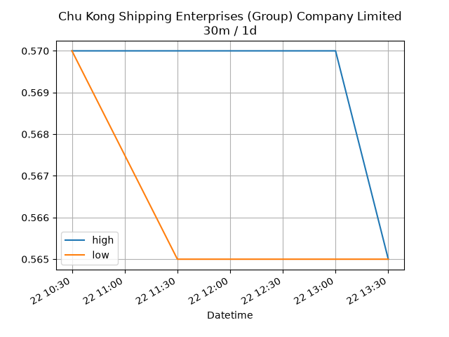|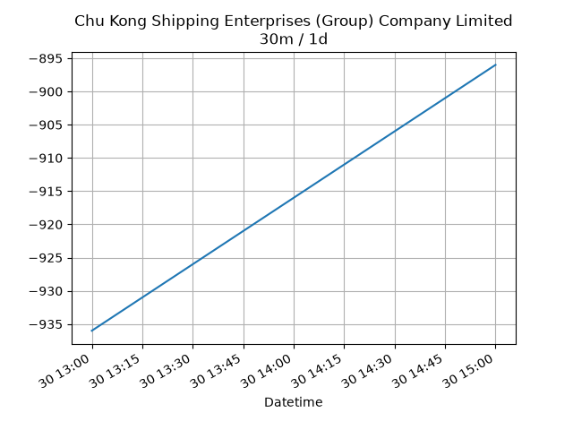|<table border="1" class="dataframe"> <thead> <tr style="text-align: center;"> <th>Datetime</th> <th>profit</th> </tr> </thead> <tbody> <tr> <td>14:00</td> <td>-876.0</td> </tr> <tr> <td>15:00</td> <td>-856.0</td> </tr> </tbody></table>|
|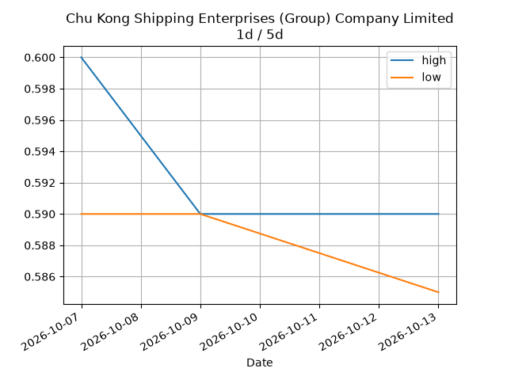|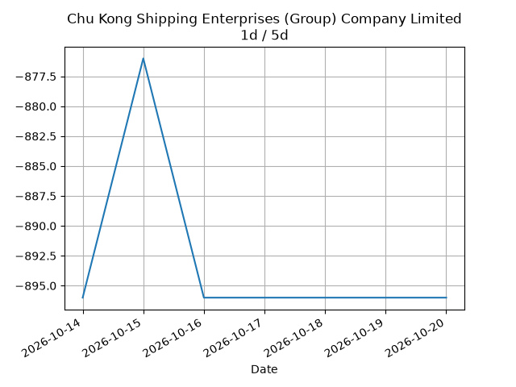|<table border="1" class="dataframe"> <thead> <tr style="text-align: center;"> <th>Date</th> <th>profit</th> </tr> </thead> <tbody> <tr> <td>2026-10-07</td> <td>-816.0</td> </tr> <tr> <td>2026-10-08</td> <td>-856.0</td> </tr> <tr> <td>2026-10-09</td> <td>-856.0</td> </tr> <tr> <td>2026-10-13</td> <td>-856.0</td> </tr> </tbody></table>|
|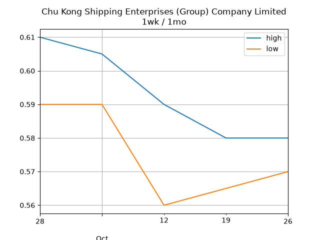|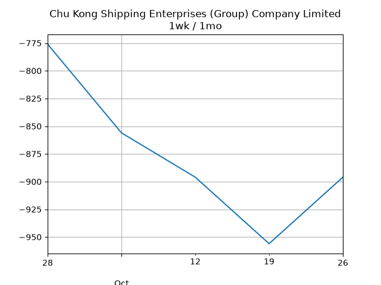|<table border="1" class="dataframe"> <thead> <tr style="text-align: center;"> <th>Date</th> <th>profit</th> </tr> </thead> <tbody> <tr> <td>2026-09-14</td> <td>-856.0</td> </tr> <tr> <td>2026-09-21</td> <td>-856.0</td> </tr> <tr> <td>2026-09-28</td> <td>-776.0</td> </tr> <tr> <td>2026-10-05</td> <td>-856.0</td> </tr> <tr> <td>2026-10-12</td> <td>-856.0</td> </tr> </tbody></table>|
---
## 0709.HK [📉] [$-1576.00] [-37.74%]:
#### Giordano International Limited
|price|profit|data|
|:---:|:---:|:---:|
|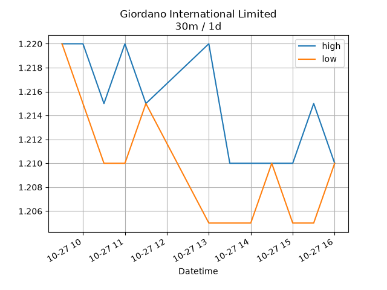|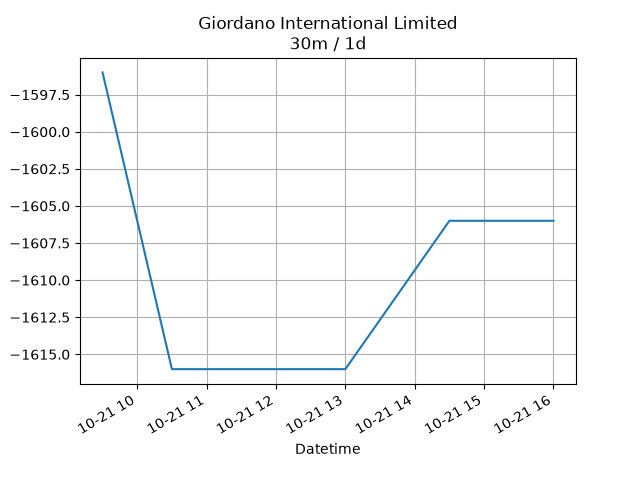|<table border="1" class="dataframe"> <thead> <tr style="text-align: center;"> <th>Datetime</th> <th>profit</th> </tr> </thead> <tbody> <tr> <td>09:30</td> <td>-1586.0</td> </tr> <tr> <td>10:00</td> <td>-1556.0</td> </tr> <tr> <td>10:30</td> <td>-1556.0</td> </tr> <tr> <td>11:00</td> <td>-1556.0</td> </tr> <tr> <td>11:30</td> <td>-1556.0</td> </tr> <tr> <td>13:00</td> <td>-1566.0</td> </tr> <tr> <td>13:30</td> <td>-1586.0</td> </tr> <tr> <td>15:00</td> <td>-1576.0</td> </tr> </tbody></table>|
|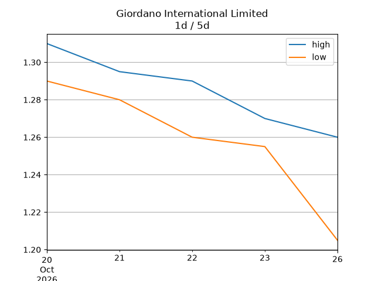|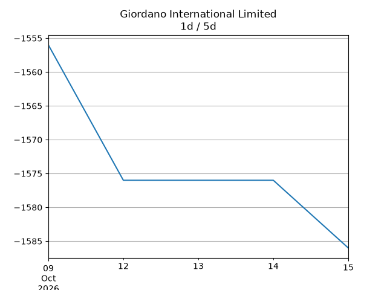|<table border="1" class="dataframe"> <thead> <tr style="text-align: center;"> <th>Date</th> <th>profit</th> </tr> </thead> <tbody> <tr> <td>2026-10-07</td> <td>-1586.0</td> </tr> <tr> <td>2026-10-08</td> <td>-1566.0</td> </tr> <tr> <td>2026-10-09</td> <td>-1556.0</td> </tr> <tr> <td>2026-10-13</td> <td>-1576.0</td> </tr> </tbody></table>|
|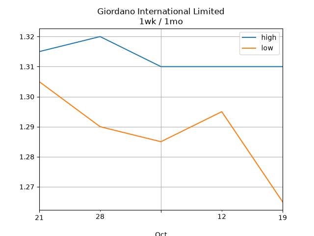|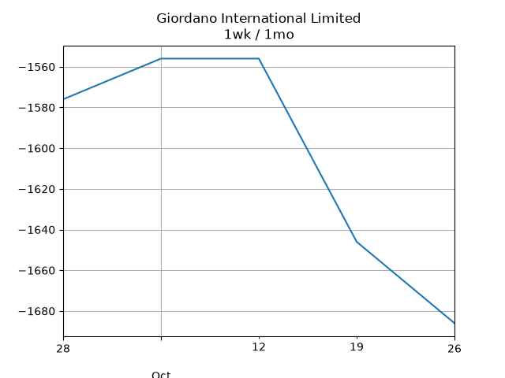|<table border="1" class="dataframe"> <thead> <tr style="text-align: center;"> <th>Date</th> <th>profit</th> </tr> </thead> <tbody> <tr> <td>2026-09-14</td> <td>-1536.0</td> </tr> <tr> <td>2026-09-21</td> <td>-1556.0</td> </tr> <tr> <td>2026-09-28</td> <td>-1576.0</td> </tr> <tr> <td>2026-10-05</td> <td>-1556.0</td> </tr> <tr> <td>2026-10-12</td> <td>-1576.0</td> </tr> </tbody></table>|
---
## 1310.HK [📉] [$-4.00] [-0.14%]:
#### HKBN Ltd.
|price|profit|data|
|:---:|:---:|:---:|
|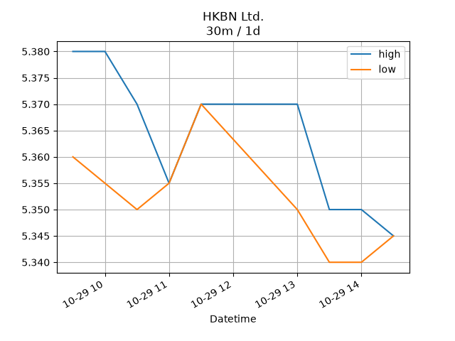|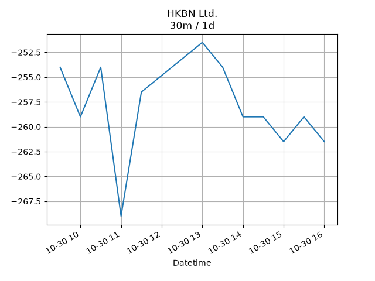|<table border="1" class="dataframe"> <thead> <tr style="text-align: center;"> <th>Datetime</th> <th>profit</th> </tr> </thead> <tbody> <tr> <td>09:30</td> <td>-16.5</td> </tr> <tr> <td>10:00</td> <td>-29.0</td> </tr> <tr> <td>10:30</td> <td>-14.0</td> </tr> <tr> <td>11:00</td> <td>-14.0</td> </tr> <tr> <td>11:30</td> <td>-9.0</td> </tr> <tr> <td>13:00</td> <td>-1.5</td> </tr> <tr> <td>13:30</td> <td>-1.5</td> </tr> <tr> <td>14:00</td> <td>-4.0</td> </tr> <tr> <td>14:30</td> <td>-4.0</td> </tr> <tr> <td>15:00</td> <td>-4.0</td> </tr> </tbody></table>|
|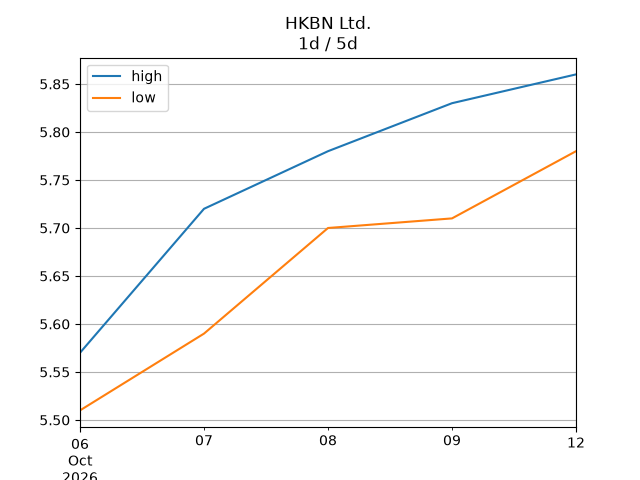|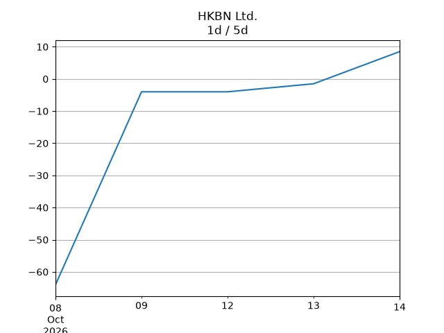|<table border="1" class="dataframe"> <thead> <tr style="text-align: center;"> <th>Date</th> <th>profit</th> </tr> </thead> <tbody> <tr> <td>2026-10-07</td> <td>-59.0</td> </tr> <tr> <td>2026-10-08</td> <td>-64.0</td> </tr> <tr> <td>2026-10-09</td> <td>-4.0</td> </tr> <tr> <td>2026-10-13</td> <td>-4.0</td> </tr> </tbody></table>|
|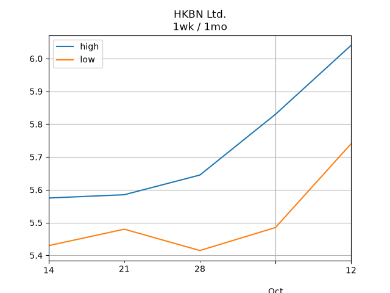|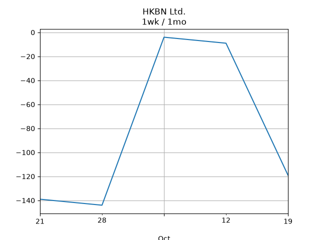|<table border="1" class="dataframe"> <thead> <tr style="text-align: center;"> <th>Date</th> <th>profit</th> </tr> </thead> <tbody> <tr> <td>2026-09-14</td> <td>-189.0</td> </tr> <tr> <td>2026-09-21</td> <td>-139.0</td> </tr> <tr> <td>2026-09-28</td> <td>-144.0</td> </tr> <tr> <td>2026-10-05</td> <td>-4.0</td> </tr> <tr> <td>2026-10-12</td> <td>-4.0</td> </tr> </tbody></table>|
---
## 2638.HK [📈] [$268.50] [9.42%]:
#### HK Electric Investments and HK Electric Investments Limited
|price|profit|data|
|:---:|:---:|:---:|
|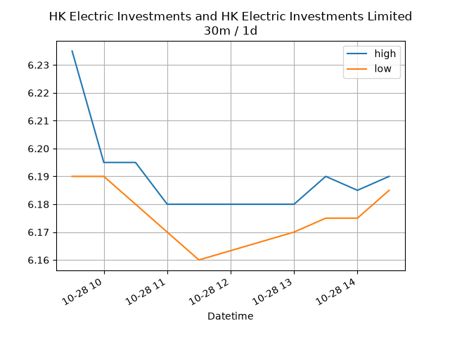|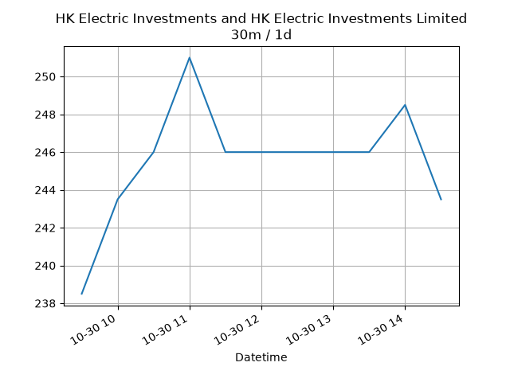|<table border="1" class="dataframe"> <thead> <tr style="text-align: center;"> <th>Datetime</th> <th>profit</th> </tr> </thead> <tbody> <tr> <td>09:30</td> <td>258.5</td> </tr> <tr> <td>10:00</td> <td>261.0</td> </tr> <tr> <td>10:30</td> <td>261.0</td> </tr> <tr> <td>11:00</td> <td>263.5</td> </tr> <tr> <td>11:30</td> <td>258.5</td> </tr> <tr> <td>13:00</td> <td>263.5</td> </tr> <tr> <td>13:30</td> <td>273.5</td> </tr> <tr> <td>14:00</td> <td>271.0</td> </tr> <tr> <td>14:30</td> <td>268.5</td> </tr> <tr> <td>15:00</td> <td>268.5</td> </tr> </tbody></table>|
|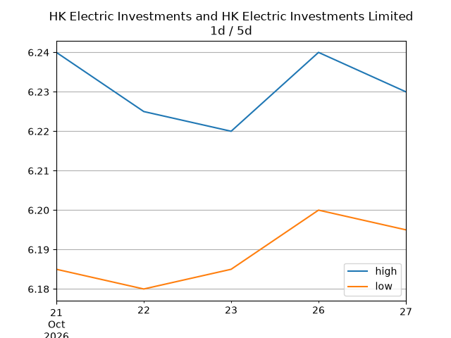|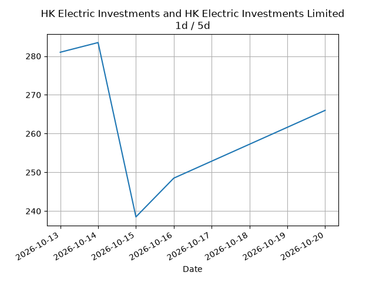|<table border="1" class="dataframe"> <thead> <tr style="text-align: center;"> <th>Date</th> <th>profit</th> </tr> </thead> <tbody> <tr> <td>2026-10-07</td> <td>253.5</td> </tr> <tr> <td>2026-10-08</td> <td>243.5</td> </tr> <tr> <td>2026-10-09</td> <td>251.0</td> </tr> <tr> <td>2026-10-13</td> <td>268.5</td> </tr> </tbody></table>|
|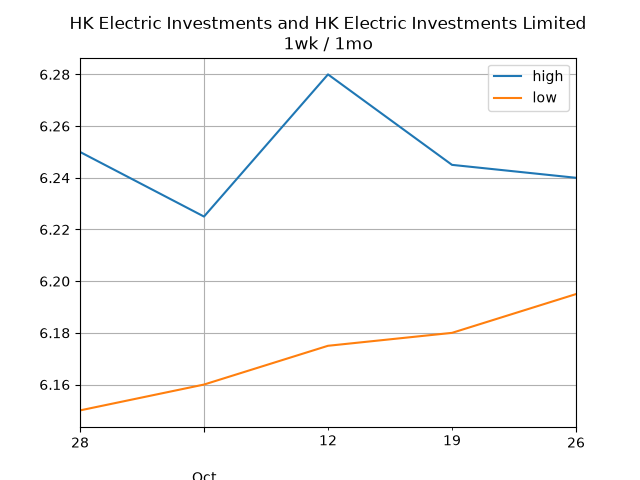|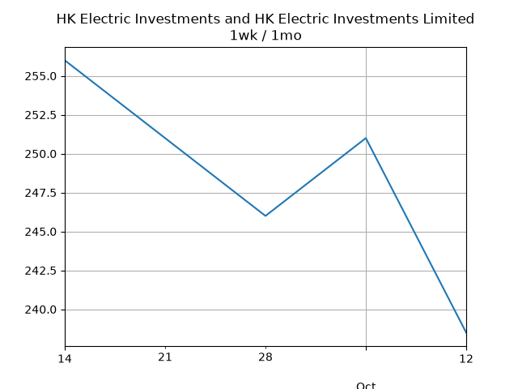|<table border="1" class="dataframe"> <thead> <tr style="text-align: center;"> <th>Date</th> <th>profit</th> </tr> </thead> <tbody> <tr> <td>2026-09-14</td> <td>256.0</td> </tr> <tr> <td>2026-09-21</td> <td>251.0</td> </tr> <tr> <td>2026-09-28</td> <td>246.0</td> </tr> <tr> <td>2026-10-05</td> <td>251.0</td> </tr> <tr> <td>2026-10-12</td> <td>268.5</td> </tr> </tbody></table>|
---
## 0533.HK [📉] [$-1575.00] [-39.62%]:
#### Goldlion Holdings Limited
|price|profit|data|
|:---:|:---:|:---:|
|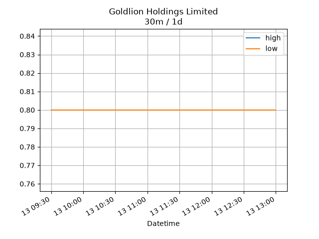|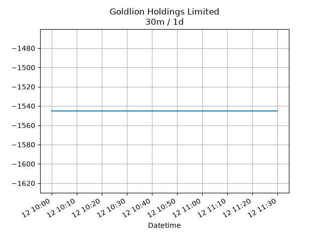|<table border="1" class="dataframe"> <thead> <tr style="text-align: center;"> <th>Datetime</th> <th>profit</th> </tr> </thead> <tbody> <tr> <td>09:30</td> <td>-1575.0</td> </tr> <tr> <td>13:00</td> <td>-1575.0</td> </tr> </tbody></table>|
|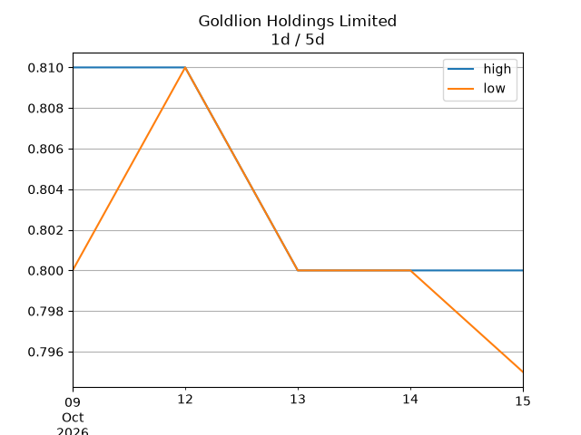|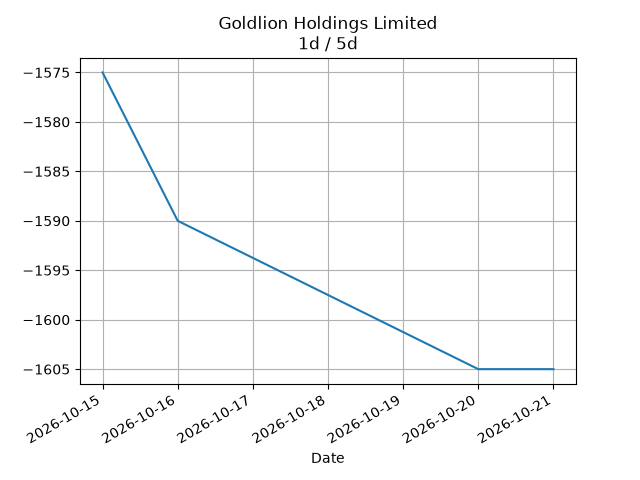|<table border="1" class="dataframe"> <thead> <tr style="text-align: center;"> <th>Date</th> <th>profit</th> </tr> </thead> <tbody> <tr> <td>2026-10-07</td> <td>-1530.0</td> </tr> <tr> <td>2026-10-08</td> <td>-1530.0</td> </tr> <tr> <td>2026-10-09</td> <td>-1545.0</td> </tr> <tr> <td>2026-10-13</td> <td>-1575.0</td> </tr> </tbody></table>|
|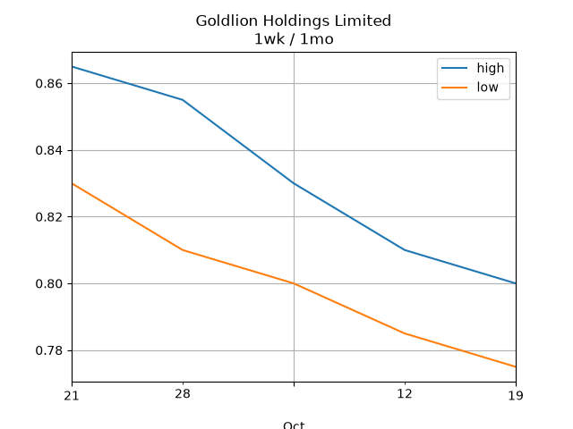|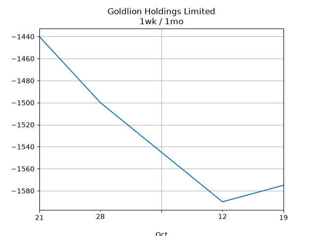|<table border="1" class="dataframe"> <thead> <tr style="text-align: center;"> <th>Date</th> <th>profit</th> </tr> </thead> <tbody> <tr> <td>2026-09-14</td> <td>-1365.0</td> </tr> <tr> <td>2026-09-21</td> <td>-1440.0</td> </tr> <tr> <td>2026-09-28</td> <td>-1500.0</td> </tr> <tr> <td>2026-10-05</td> <td>-1545.0</td> </tr> <tr> <td>2026-10-12</td> <td>-1575.0</td> </tr> </tbody></table>|
---
## 2618.HK [📉] [$-354.00] [-25.47%]:
#### JD Logistics, Inc.
|price|profit|data|
|:---:|:---:|:---:|
|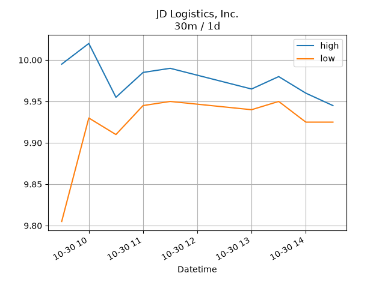|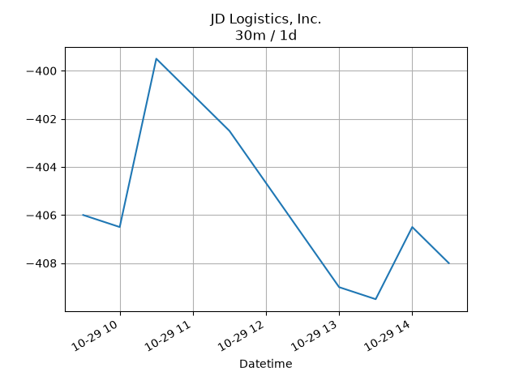|<table border="1" class="dataframe"> <thead> <tr style="text-align: center;"> <th>Datetime</th> <th>profit</th> </tr> </thead> <tbody> <tr> <td>09:30</td> <td>-362.0</td> </tr> <tr> <td>10:00</td> <td>-367.0</td> </tr> <tr> <td>10:30</td> <td>-363.0</td> </tr> <tr> <td>11:00</td> <td>-357.0</td> </tr> <tr> <td>11:30</td> <td>-358.0</td> </tr> <tr> <td>13:00</td> <td>-352.0</td> </tr> <tr> <td>13:30</td> <td>-353.0</td> </tr> <tr> <td>14:00</td> <td>-355.0</td> </tr> <tr> <td>14:30</td> <td>-353.0</td> </tr> <tr> <td>15:00</td> <td>-354.0</td> </tr> </tbody></table>|
|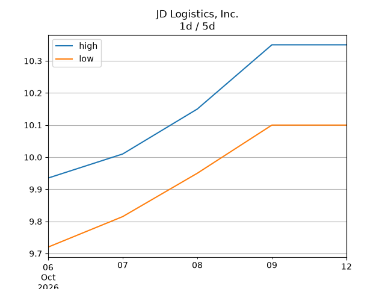|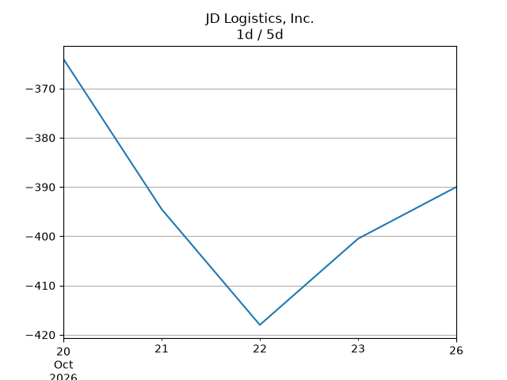|<table border="1" class="dataframe"> <thead> <tr style="text-align: center;"> <th>Date</th> <th>profit</th> </tr> </thead> <tbody> <tr> <td>2026-10-07</td> <td>-393.5</td> </tr> <tr> <td>2026-10-08</td> <td>-384.0</td> </tr> <tr> <td>2026-10-09</td> <td>-359.0</td> </tr> <tr> <td>2026-10-13</td> <td>-354.0</td> </tr> </tbody></table>|
|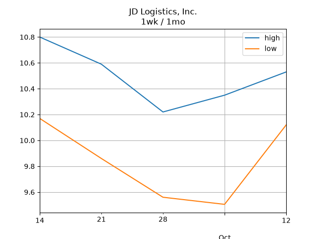|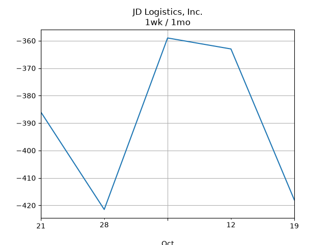|<table border="1" class="dataframe"> <thead> <tr style="text-align: center;"> <th>Date</th> <th>profit</th> </tr> </thead> <tbody> <tr> <td>2026-09-14</td> <td>-343.0</td> </tr> <tr> <td>2026-09-21</td> <td>-386.0</td> </tr> <tr> <td>2026-09-28</td> <td>-421.5</td> </tr> <tr> <td>2026-10-05</td> <td>-359.0</td> </tr> <tr> <td>2026-10-12</td> <td>-354.0</td> </tr> </tbody></table>|
---
