## Net Profit [📉]:
### $-4644.00
|type|graph|data|
|:---:|:---:|:---:|
|30m / 1d|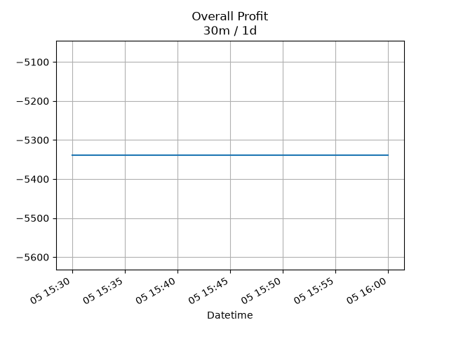||
|1d / 5d|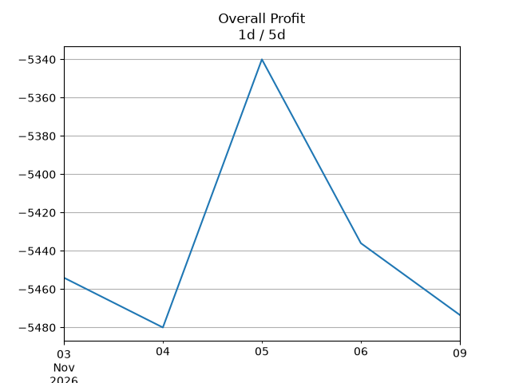|<table border="1" class="dataframe"> <thead> <tr style="text-align: center;"> <th>Date</th> <th>profit</th> </tr> </thead> <tbody> <tr> <td>2026-11-02</td> <td>-5456.5</td> </tr> <tr> <td>2026-11-03</td> <td>-5454.0</td> </tr> <tr> <td>2026-11-04</td> <td>-5480.0</td> </tr> <tr> <td>2026-11-05</td> <td>-5340.0</td> </tr> <tr> <td>2026-11-06</td> <td>-5340.0</td> </tr> </tbody></table>|
|1wk / 1mo|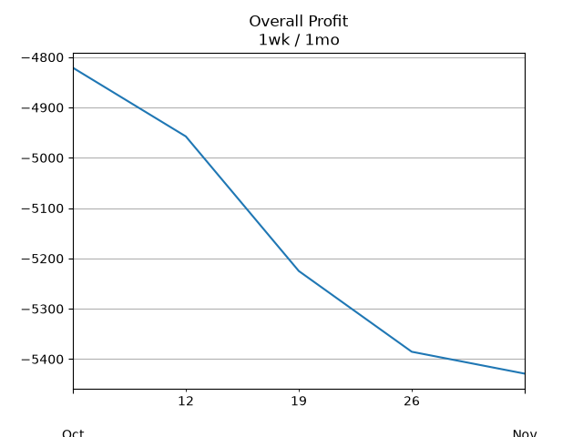|<table border="1" class="dataframe"> <thead> <tr style="text-align: center;"> <th>Date</th> <th>profit</th> </tr> </thead> <tbody> <tr> <td>2026-10-05</td> <td>-4821.0</td> </tr> <tr> <td>2026-10-12</td> <td>-4957.5</td> </tr> <tr> <td>2026-10-19</td> <td>-5225.0</td> </tr> <tr> <td>2026-10-26</td> <td>-5385.5</td> </tr> <tr> <td>2026-11-02</td> <td>-5436.0</td> </tr> </tbody></table>|
---
## 0573.HK [📈] [$0.00] [0.00%]:
#### Tao Heung Holdings Limited
|price|profit|data|
|:---:|:---:|:---:|
|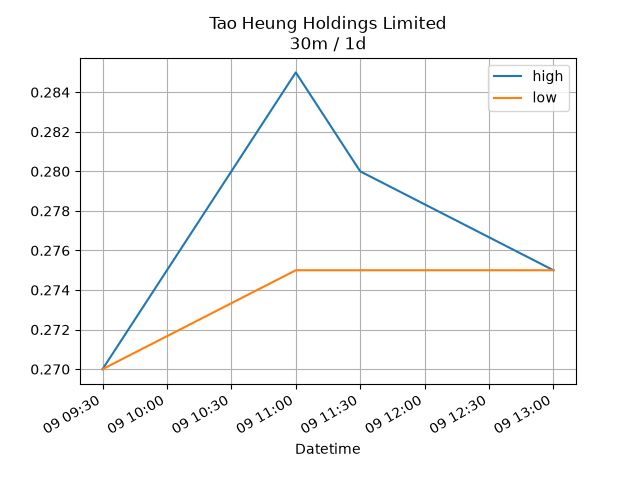|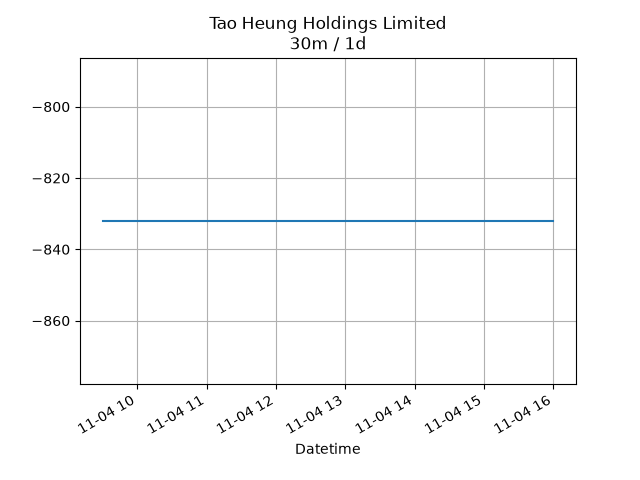|<table border="1" class="dataframe"> <thead> <tr style="text-align: center;"> <th>index</th> <th>profit</th> </tr> </thead> <tbody> <tr> <td>00:00</td> <td>0</td> </tr> </tbody></table>|
|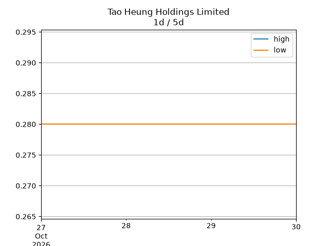|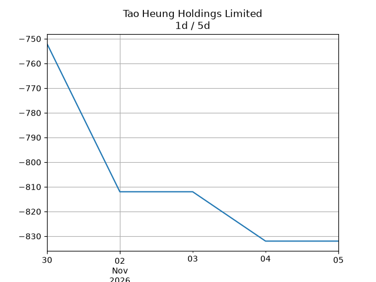|<table border="1" class="dataframe"> <thead> <tr style="text-align: center;"> <th>Date</th> <th>profit</th> </tr> </thead> <tbody> <tr> <td>2026-11-02</td> <td>-812.0</td> </tr> <tr> <td>2026-11-03</td> <td>-812.0</td> </tr> <tr> <td>2026-11-04</td> <td>-832.0</td> </tr> <tr> <td>2026-11-05</td> <td>-792.0</td> </tr> </tbody></table>|
|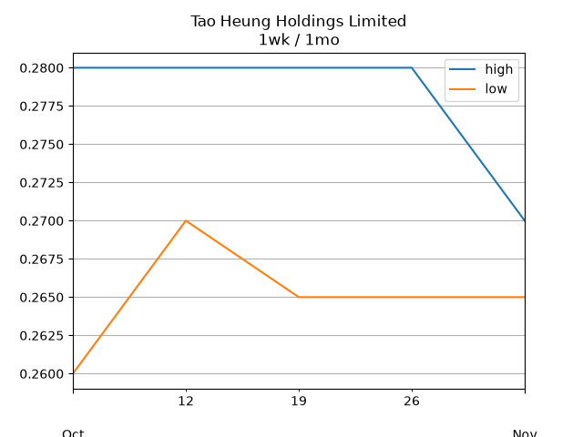|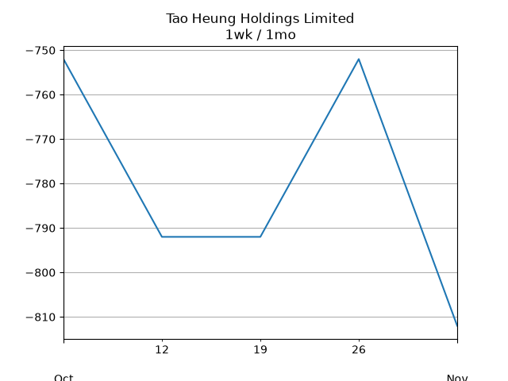|<table border="1" class="dataframe"> <thead> <tr style="text-align: center;"> <th>Date</th> <th>profit</th> </tr> </thead> <tbody> <tr> <td>2026-10-05</td> <td>-752.0</td> </tr> <tr> <td>2026-10-12</td> <td>-792.0</td> </tr> <tr> <td>2026-10-19</td> <td>-792.0</td> </tr> <tr> <td>2026-10-26</td> <td>-752.0</td> </tr> <tr> <td>2026-11-02</td> <td>-792.0</td> </tr> </tbody></table>|
---
## 0560.HK [📉] [$-936.00] [-29.10%]:
#### Chu Kong Shipping Enterprises (Group) Company Limited
|price|profit|data|
|:---:|:---:|:---:|
|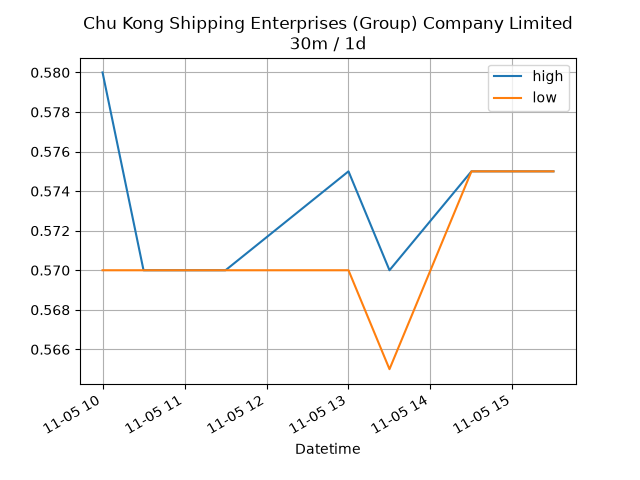|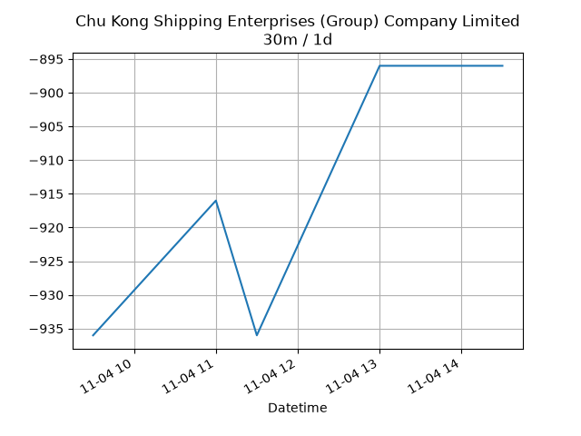|<table border="1" class="dataframe"> <thead> <tr style="text-align: center;"> <th>Datetime</th> <th>profit</th> </tr> </thead> <tbody> <tr> <td>11:30</td> <td>-916.0</td> </tr> <tr> <td>13:00</td> <td>-916.0</td> </tr> <tr> <td>14:30</td> <td>-936.0</td> </tr> </tbody></table>|
|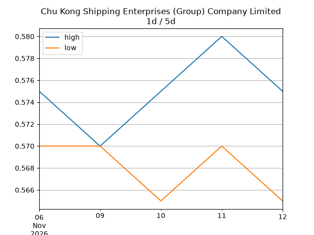|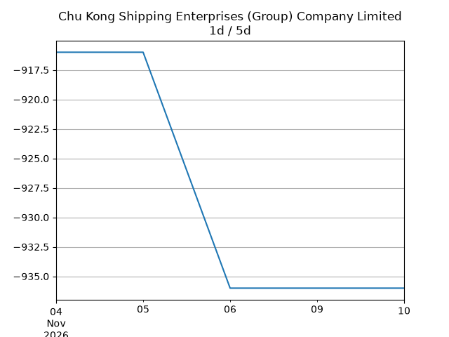|<table border="1" class="dataframe"> <thead> <tr style="text-align: center;"> <th>Date</th> <th>profit</th> </tr> </thead> <tbody> <tr> <td>2026-11-02</td> <td>-896.0</td> </tr> <tr> <td>2026-11-03</td> <td>-896.0</td> </tr> <tr> <td>2026-11-04</td> <td>-916.0</td> </tr> <tr> <td>2026-11-05</td> <td>-916.0</td> </tr> <tr> <td>2026-11-06</td> <td>-936.0</td> </tr> </tbody></table>|
|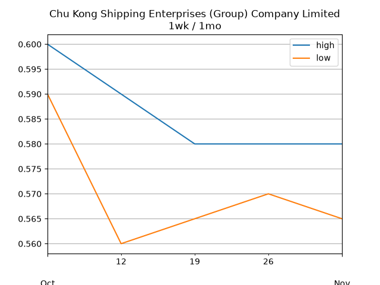|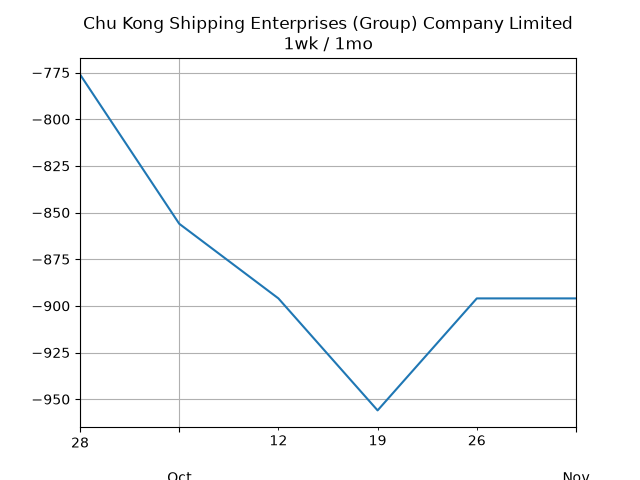|<table border="1" class="dataframe"> <thead> <tr style="text-align: center;"> <th>Date</th> <th>profit</th> </tr> </thead> <tbody> <tr> <td>2026-10-05</td> <td>-856.0</td> </tr> <tr> <td>2026-10-12</td> <td>-896.0</td> </tr> <tr> <td>2026-10-19</td> <td>-956.0</td> </tr> <tr> <td>2026-10-26</td> <td>-896.0</td> </tr> <tr> <td>2026-11-02</td> <td>-936.0</td> </tr> </tbody></table>|
---
## 0709.HK [📉] [$-1716.00] [-41.09%]:
#### Giordano International Limited
|price|profit|data|
|:---:|:---:|:---:|
|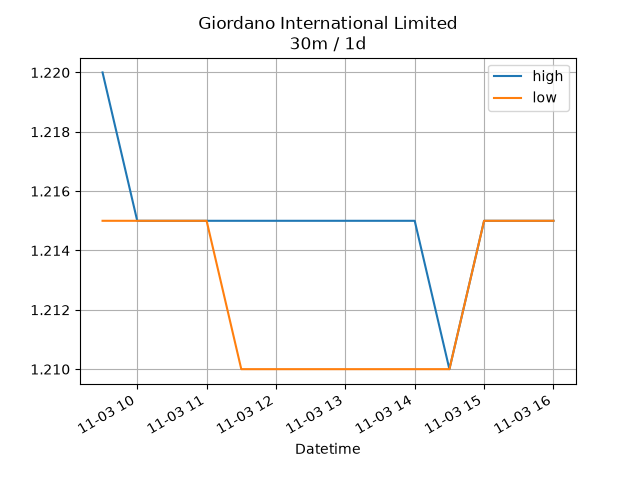|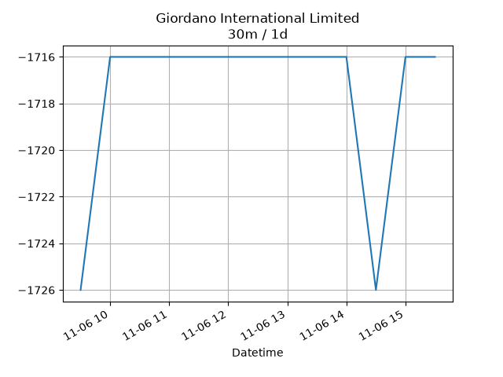|<table border="1" class="dataframe"> <thead> <tr style="text-align: center;"> <th>Datetime</th> <th>profit</th> </tr> </thead> <tbody> <tr> <td>09:30</td> <td>-1726.0</td> </tr> <tr> <td>10:00</td> <td>-1716.0</td> </tr> <tr> <td>10:30</td> <td>-1716.0</td> </tr> <tr> <td>11:00</td> <td>-1716.0</td> </tr> <tr> <td>11:30</td> <td>-1716.0</td> </tr> <tr> <td>13:30</td> <td>-1716.0</td> </tr> <tr> <td>14:00</td> <td>-1716.0</td> </tr> <tr> <td>14:30</td> <td>-1726.0</td> </tr> <tr> <td>15:00</td> <td>-1716.0</td> </tr> <tr> <td>15:30</td> <td>-1716.0</td> </tr> </tbody></table>|
|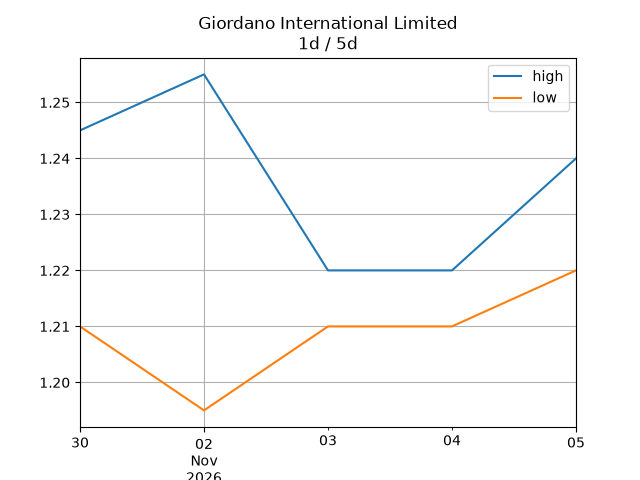|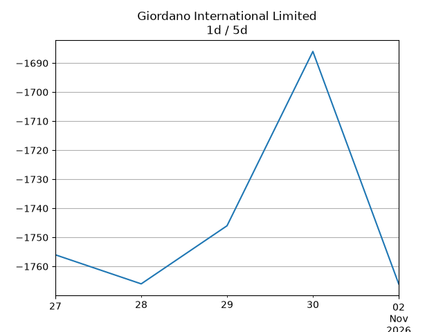|<table border="1" class="dataframe"> <thead> <tr style="text-align: center;"> <th>Date</th> <th>profit</th> </tr> </thead> <tbody> <tr> <td>2026-11-02</td> <td>-1746.0</td> </tr> <tr> <td>2026-11-03</td> <td>-1746.0</td> </tr> <tr> <td>2026-11-04</td> <td>-1736.0</td> </tr> <tr> <td>2026-11-05</td> <td>-1716.0</td> </tr> <tr> <td>2026-11-06</td> <td>-1716.0</td> </tr> </tbody></table>|
|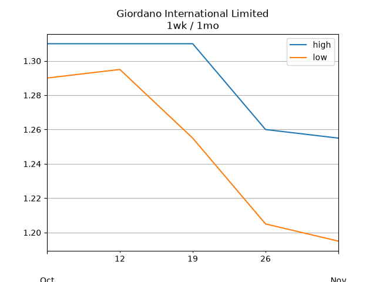|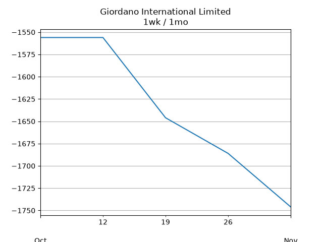|<table border="1" class="dataframe"> <thead> <tr style="text-align: center;"> <th>Date</th> <th>profit</th> </tr> </thead> <tbody> <tr> <td>2026-10-05</td> <td>-1556.0</td> </tr> <tr> <td>2026-10-12</td> <td>-1556.0</td> </tr> <tr> <td>2026-10-19</td> <td>-1646.0</td> </tr> <tr> <td>2026-10-26</td> <td>-1686.0</td> </tr> <tr> <td>2026-11-02</td> <td>-1716.0</td> </tr> </tbody></table>|
---
## 1310.HK [📉] [$-206.50] [-7.07%]:
#### HKBN Ltd.
|price|profit|data|
|:---:|:---:|:---:|
|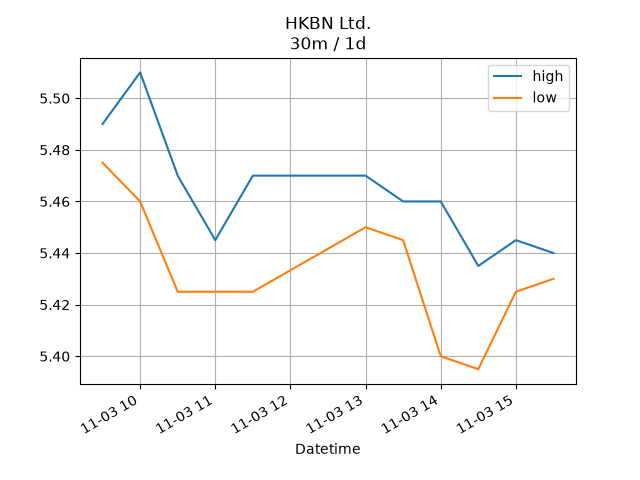|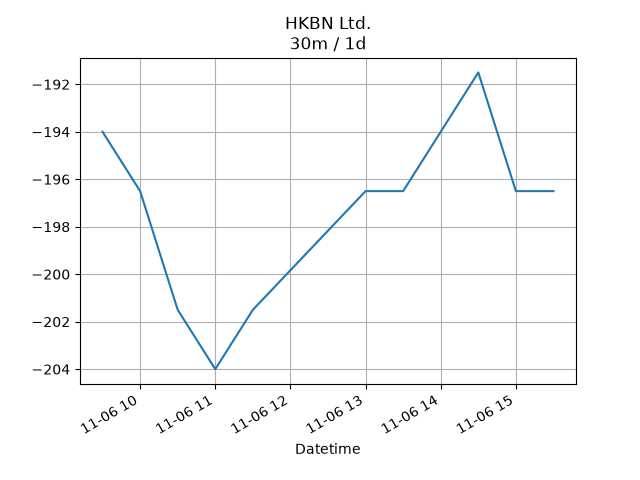|<table border="1" class="dataframe"> <thead> <tr style="text-align: center;"> <th>Datetime</th> <th>profit</th> </tr> </thead> <tbody> <tr> <td>09:30</td> <td>-194.0</td> </tr> <tr> <td>10:00</td> <td>-196.5</td> </tr> <tr> <td>10:30</td> <td>-201.5</td> </tr> <tr> <td>11:00</td> <td>-204.0</td> </tr> <tr> <td>11:30</td> <td>-201.5</td> </tr> <tr> <td>13:00</td> <td>-196.5</td> </tr> <tr> <td>13:30</td> <td>-196.5</td> </tr> <tr> <td>14:00</td> <td>-194.0</td> </tr> <tr> <td>14:30</td> <td>-191.5</td> </tr> <tr> <td>15:00</td> <td>-196.5</td> </tr> <tr> <td>15:30</td> <td>-206.5</td> </tr> <tr> <td>16:00</td> <td>-206.5</td> </tr> </tbody></table>|
|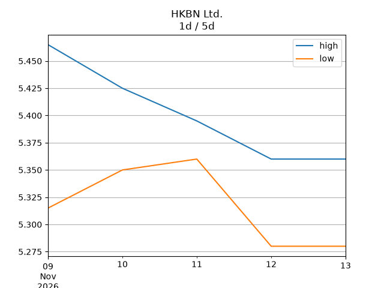|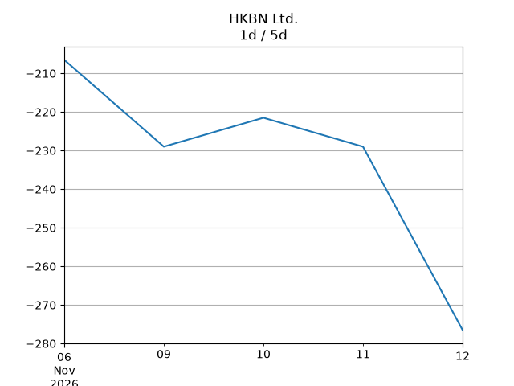|<table border="1" class="dataframe"> <thead> <tr style="text-align: center;"> <th>Date</th> <th>profit</th> </tr> </thead> <tbody> <tr> <td>2026-11-02</td> <td>-189.0</td> </tr> <tr> <td>2026-11-03</td> <td>-196.5</td> </tr> <tr> <td>2026-11-04</td> <td>-189.0</td> </tr> <tr> <td>2026-11-05</td> <td>-176.5</td> </tr> <tr> <td>2026-11-06</td> <td>-206.5</td> </tr> </tbody></table>|
|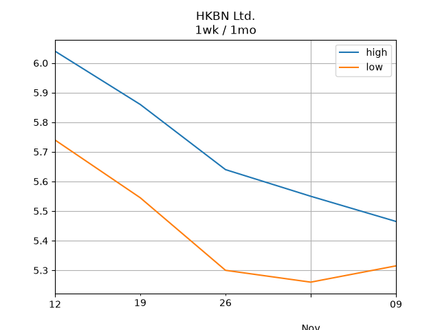|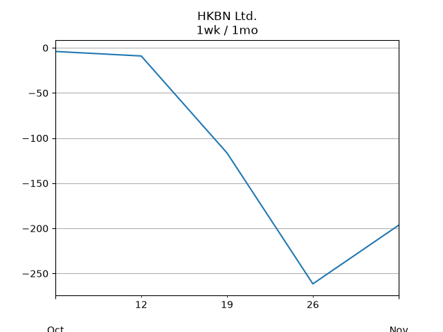|<table border="1" class="dataframe"> <thead> <tr style="text-align: center;"> <th>Date</th> <th>profit</th> </tr> </thead> <tbody> <tr> <td>2026-10-05</td> <td>-4.0</td> </tr> <tr> <td>2026-10-12</td> <td>-9.0</td> </tr> <tr> <td>2026-10-19</td> <td>-116.5</td> </tr> <tr> <td>2026-10-26</td> <td>-261.5</td> </tr> <tr> <td>2026-11-02</td> <td>-206.5</td> </tr> </tbody></table>|
---
## 2638.HK [📈] [$253.50] [8.90%]:
#### HK Electric Investments and HK Electric Investments Limited
|price|profit|data|
|:---:|:---:|:---:|
|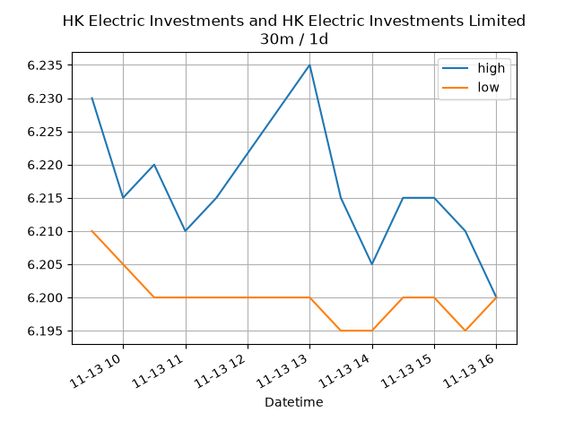|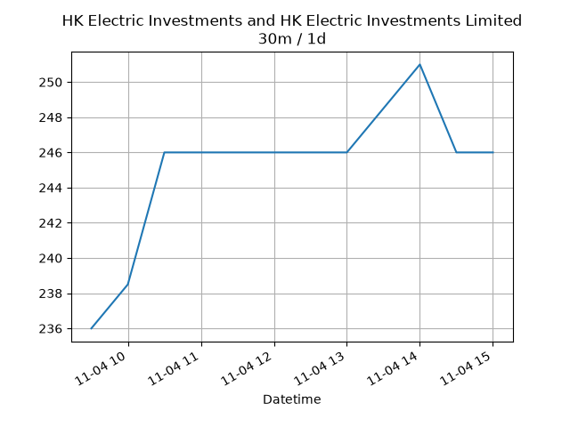|<table border="1" class="dataframe"> <thead> <tr style="text-align: center;"> <th>Datetime</th> <th>profit</th> </tr> </thead> <tbody> <tr> <td>09:30</td> <td>256.0</td> </tr> <tr> <td>10:00</td> <td>253.5</td> </tr> <tr> <td>10:30</td> <td>258.5</td> </tr> <tr> <td>11:00</td> <td>256.0</td> </tr> <tr> <td>11:30</td> <td>258.5</td> </tr> <tr> <td>13:00</td> <td>253.5</td> </tr> <tr> <td>13:30</td> <td>253.5</td> </tr> <tr> <td>14:00</td> <td>256.0</td> </tr> <tr> <td>14:30</td> <td>256.0</td> </tr> <tr> <td>15:00</td> <td>256.0</td> </tr> <tr> <td>15:30</td> <td>256.0</td> </tr> <tr> <td>16:00</td> <td>253.5</td> </tr> </tbody></table>|
|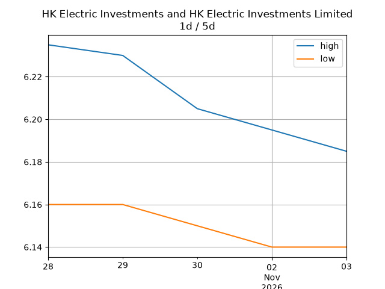|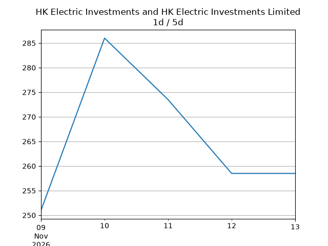|<table border="1" class="dataframe"> <thead> <tr style="text-align: center;"> <th>Date</th> <th>profit</th> </tr> </thead> <tbody> <tr> <td>2026-11-02</td> <td>236.0</td> </tr> <tr> <td>2026-11-03</td> <td>233.5</td> </tr> <tr> <td>2026-11-04</td> <td>246.0</td> </tr> <tr> <td>2026-11-05</td> <td>263.5</td> </tr> <tr> <td>2026-11-06</td> <td>253.5</td> </tr> </tbody></table>|
|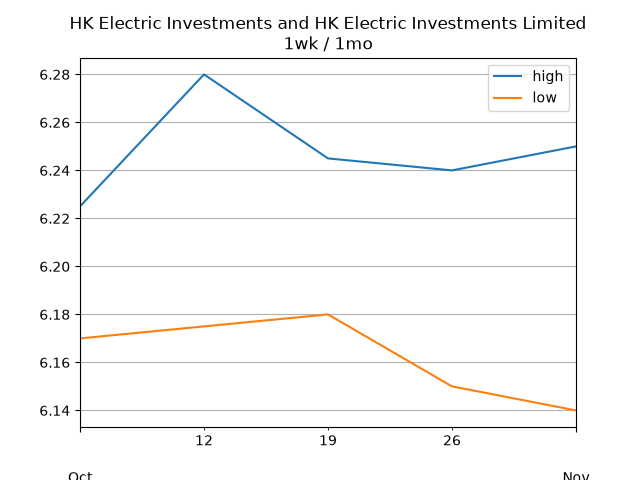|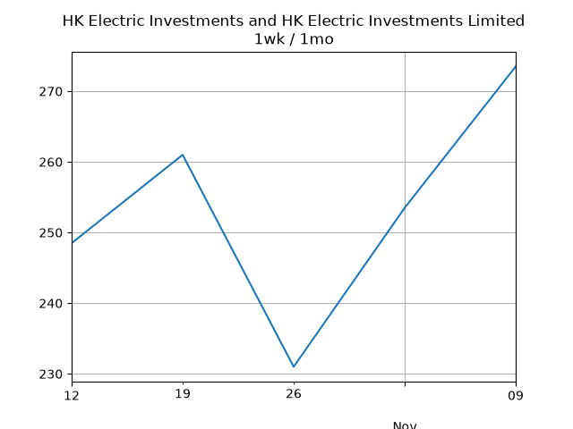|<table border="1" class="dataframe"> <thead> <tr style="text-align: center;"> <th>Date</th> <th>profit</th> </tr> </thead> <tbody> <tr> <td>2026-10-05</td> <td>251.0</td> </tr> <tr> <td>2026-10-12</td> <td>248.5</td> </tr> <tr> <td>2026-10-19</td> <td>261.0</td> </tr> <tr> <td>2026-10-26</td> <td>231.0</td> </tr> <tr> <td>2026-11-02</td> <td>253.5</td> </tr> </tbody></table>|
---
## 0533.HK [📉] [$-1725.00] [-43.40%]:
#### Goldlion Holdings Limited
|price|profit|data|
|:---:|:---:|:---:|
|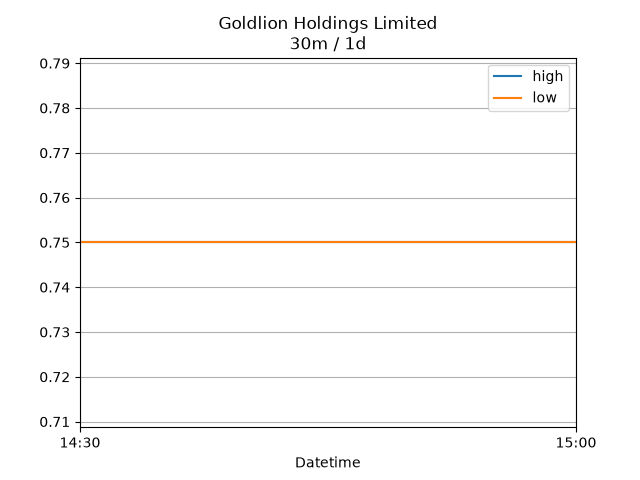|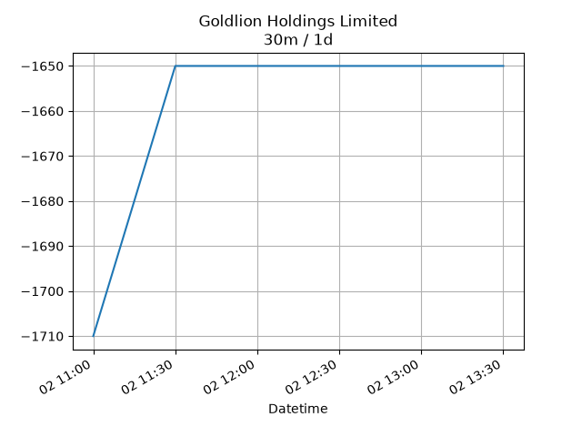|<table border="1" class="dataframe"> <thead> <tr style="text-align: center;"> <th>Datetime</th> <th>profit</th> </tr> </thead> <tbody> <tr> <td>10:30</td> <td>-1695.0</td> </tr> <tr> <td>11:30</td> <td>-1740.0</td> </tr> <tr> <td>13:00</td> <td>-1740.0</td> </tr> <tr> <td>13:30</td> <td>-1740.0</td> </tr> <tr> <td>14:00</td> <td>-1740.0</td> </tr> <tr> <td>14:30</td> <td>-1725.0</td> </tr> </tbody></table>|
|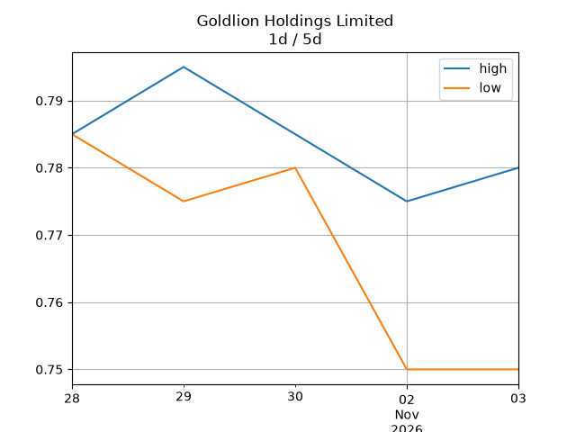|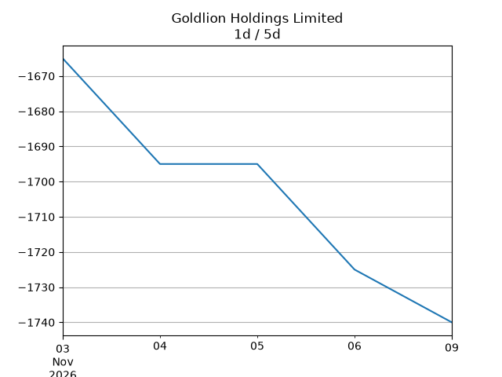|<table border="1" class="dataframe"> <thead> <tr style="text-align: center;"> <th>Date</th> <th>profit</th> </tr> </thead> <tbody> <tr> <td>2026-11-02</td> <td>-1650.0</td> </tr> <tr> <td>2026-11-03</td> <td>-1665.0</td> </tr> <tr> <td>2026-11-04</td> <td>-1695.0</td> </tr> <tr> <td>2026-11-05</td> <td>-1695.0</td> </tr> <tr> <td>2026-11-06</td> <td>-1725.0</td> </tr> </tbody></table>|
|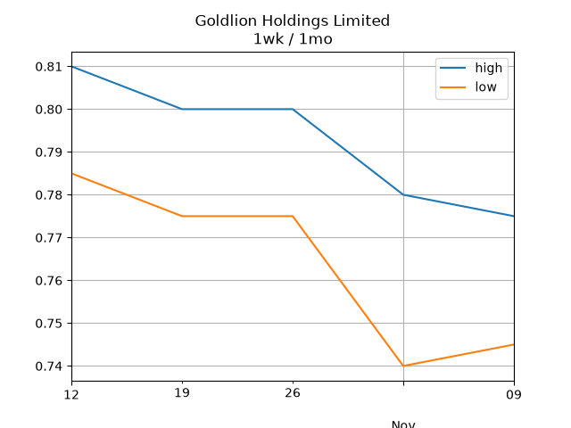|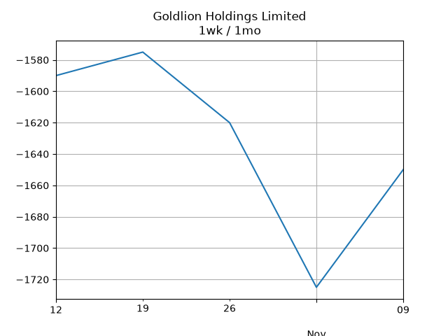|<table border="1" class="dataframe"> <thead> <tr style="text-align: center;"> <th>Date</th> <th>profit</th> </tr> </thead> <tbody> <tr> <td>2026-10-05</td> <td>-1545.0</td> </tr> <tr> <td>2026-10-12</td> <td>-1590.0</td> </tr> <tr> <td>2026-10-19</td> <td>-1575.0</td> </tr> <tr> <td>2026-10-26</td> <td>-1620.0</td> </tr> <tr> <td>2026-11-02</td> <td>-1725.0</td> </tr> </tbody></table>|
---
## 2618.HK [📉] [$-314.00] [-22.59%]:
#### JD Logistics, Inc.
|price|profit|data|
|:---:|:---:|:---:|
|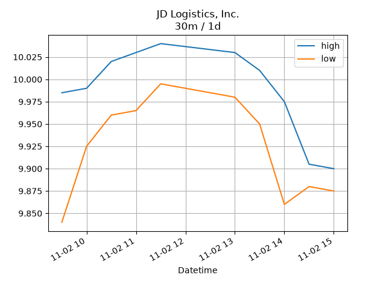|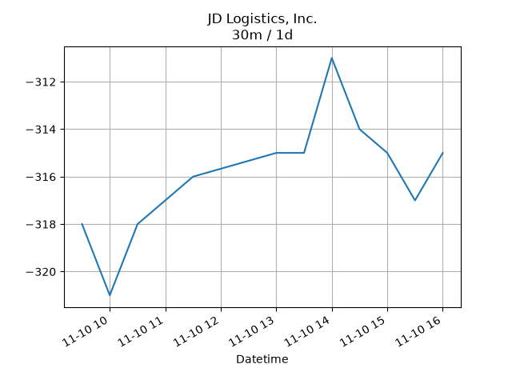|<table border="1" class="dataframe"> <thead> <tr style="text-align: center;"> <th>Datetime</th> <th>profit</th> </tr> </thead> <tbody> <tr> <td>09:30</td> <td>-312.0</td> </tr> <tr> <td>10:00</td> <td>-310.0</td> </tr> <tr> <td>10:30</td> <td>-308.0</td> </tr> <tr> <td>11:00</td> <td>-312.0</td> </tr> <tr> <td>11:30</td> <td>-313.0</td> </tr> <tr> <td>13:00</td> <td>-315.0</td> </tr> <tr> <td>13:30</td> <td>-313.0</td> </tr> <tr> <td>14:00</td> <td>-311.0</td> </tr> <tr> <td>14:30</td> <td>-313.0</td> </tr> <tr> <td>15:00</td> <td>-317.0</td> </tr> <tr> <td>15:30</td> <td>-314.0</td> </tr> <tr> <td>16:00</td> <td>-314.0</td> </tr> </tbody></table>|
|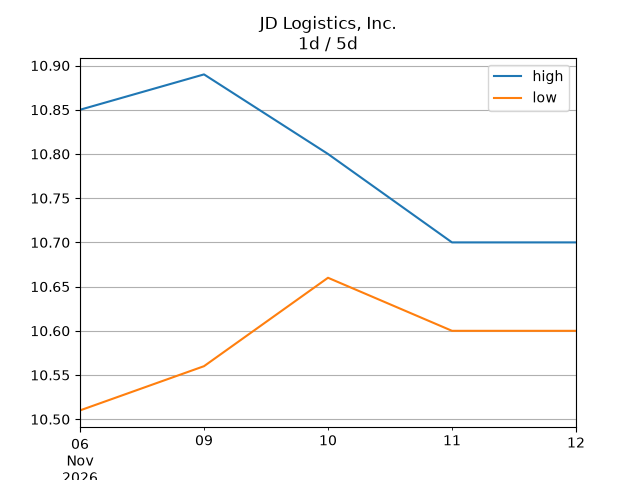|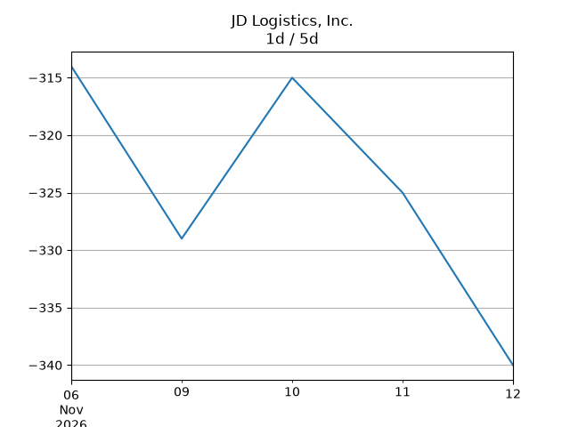|<table border="1" class="dataframe"> <thead> <tr style="text-align: center;"> <th>Date</th> <th>profit</th> </tr> </thead> <tbody> <tr> <td>2026-11-02</td> <td>-399.5</td> </tr> <tr> <td>2026-11-03</td> <td>-372.0</td> </tr> <tr> <td>2026-11-04</td> <td>-358.0</td> </tr> <tr> <td>2026-11-05</td> <td>-308.0</td> </tr> <tr> <td>2026-11-06</td> <td>-314.0</td> </tr> </tbody></table>|
|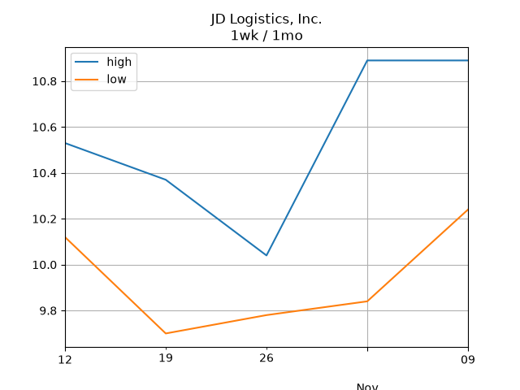|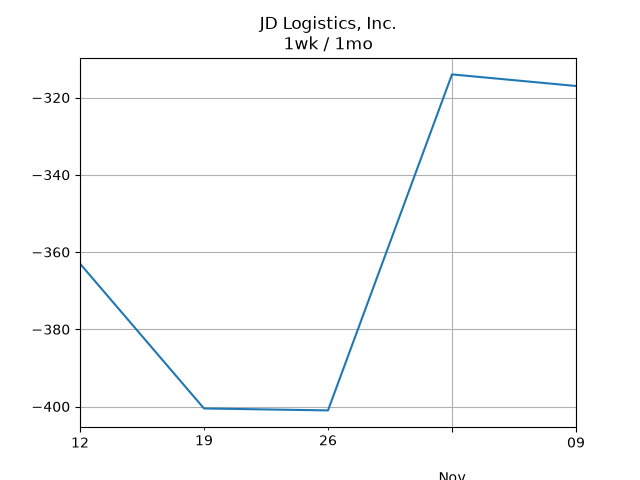|<table border="1" class="dataframe"> <thead> <tr style="text-align: center;"> <th>Date</th> <th>profit</th> </tr> </thead> <tbody> <tr> <td>2026-10-05</td> <td>-359.0</td> </tr> <tr> <td>2026-10-12</td> <td>-363.0</td> </tr> <tr> <td>2026-10-19</td> <td>-400.5</td> </tr> <tr> <td>2026-10-26</td> <td>-401.0</td> </tr> <tr> <td>2026-11-02</td> <td>-314.0</td> </tr> </tbody></table>|
---
