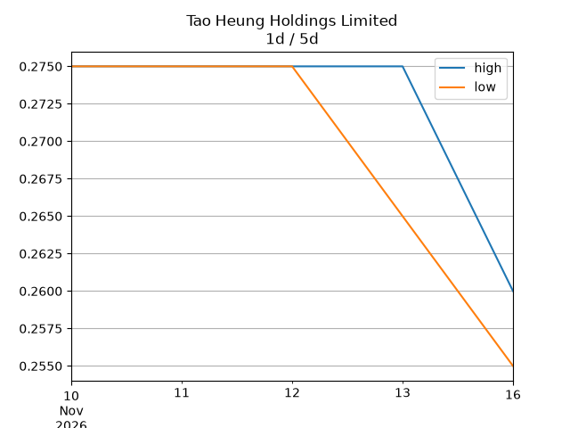
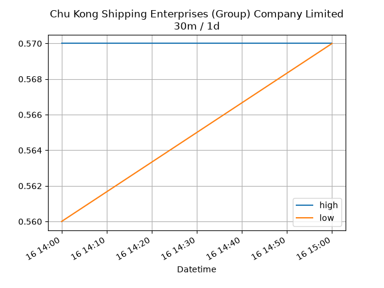
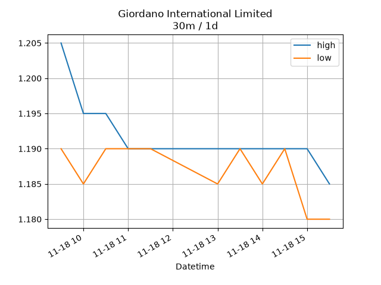
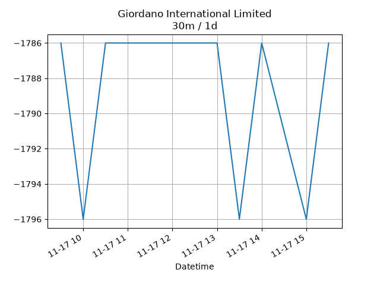
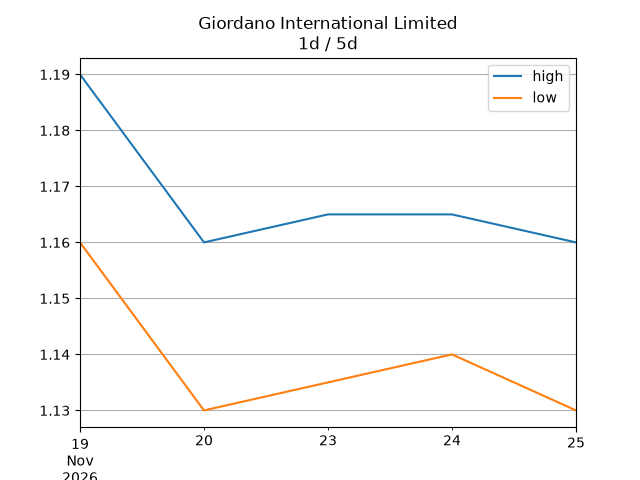
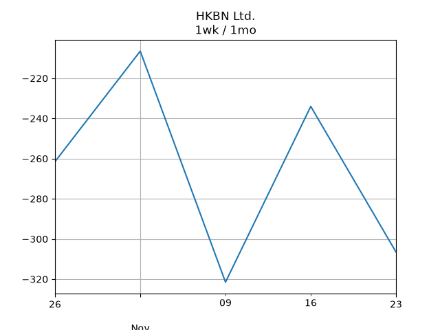
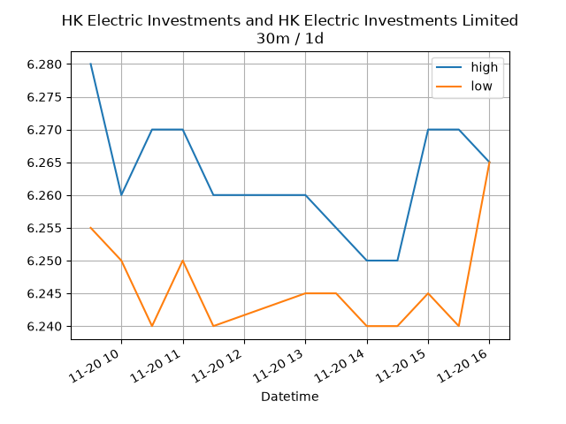
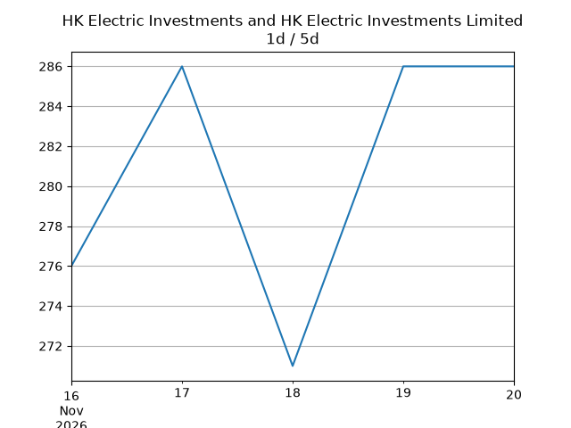
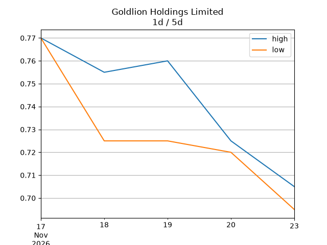
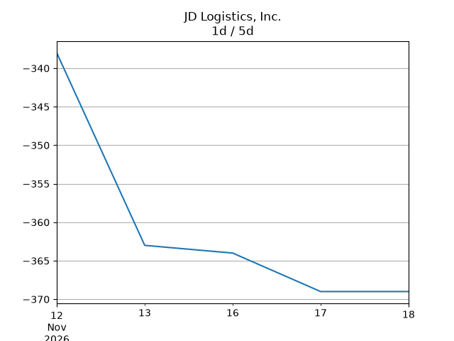

## Net Profit [📉]:
### $-6115.00
|type|graph|data|
|:---:|:---:|:---:|
|30m / 1d||<table border="1" class="dataframe"> <thead> <tr style="text-align: center;"> <th>Datetime</th> <th>profit</th> </tr> </thead> <tbody> <tr> <td>09:30</td> <td>NaN</td> </tr> <tr> <td>10:00</td> <td>NaN</td> </tr> <tr> <td>10:30</td> <td>NaN</td> </tr> <tr> <td>11:00</td> <td>NaN</td> </tr> <tr> <td>11:30</td> <td>NaN</td> </tr> <tr> <td>13:00</td> <td>NaN</td> </tr> <tr> <td>13:30</td> <td>NaN</td> </tr> <tr> <td>14:00</td> <td>NaN</td> </tr> <tr> <td>14:30</td> <td>NaN</td> </tr> <tr> <td>15:00</td> <td>NaN</td> </tr> <tr> <td>15:30</td> <td>NaN</td> </tr> <tr> <td>16:00</td> <td>NaN</td> </tr> </tbody></table>|
|1d / 5d||<table border="1" class="dataframe"> <thead> <tr style="text-align: center;"> <th>Date</th> <th>profit</th> </tr> </thead> <tbody> <tr> <td>2026-11-19</td> <td>-5842.5</td> </tr> <tr> <td>2026-11-20</td> <td>-5916.0</td> </tr> <tr> <td>2026-11-23</td> <td>-5968.0</td> </tr> <tr> <td>2026-11-24</td> <td>-6058.5</td> </tr> <tr> <td>2026-11-25</td> <td>-6115.0</td> </tr> </tbody></table>|
|1wk / 1mo||<table border="1" class="dataframe"> <thead> <tr style="text-align: center;"> <th>Date</th> <th>profit</th> </tr> </thead> <tbody> <tr> <td>2026-10-26</td> <td>-5385.5</td> </tr> <tr> <td>2026-11-02</td> <td>-5436.0</td> </tr> <tr> <td>2026-11-09</td> <td>-5622.5</td> </tr> <tr> <td>2026-11-16</td> <td>-5916.0</td> </tr> <tr> <td>2026-11-23</td> <td>-6115.0</td> </tr> </tbody></table>|
---
## 0573.HK [📉] [$-832.00] [-44.44%]:
#### Tao Heung Holdings Limited
|price|profit|data|
|:---:|:---:|:---:|
|||<table border="1" class="dataframe"> <thead> <tr style="text-align: center;"> <th>Datetime</th> <th>profit</th> </tr> </thead> <tbody> <tr> <td>14:30</td> <td>-832.0</td> </tr> <tr> <td>16:00</td> <td>-832.0</td> </tr> </tbody></table>|
|||<table border="1" class="dataframe"> <thead> <tr style="text-align: center;"> <th>Date</th> <th>profit</th> </tr> </thead> <tbody> <tr> <td>2026-11-19</td> <td>-852.0</td> </tr> <tr> <td>2026-11-20</td> <td>-852.0</td> </tr> <tr> <td>2026-11-23</td> <td>-792.0</td> </tr> <tr> <td>2026-11-24</td> <td>-792.0</td> </tr> <tr> <td>2026-11-25</td> <td>-832.0</td> </tr> </tbody></table>|
|||<table border="1" class="dataframe"> <thead> <tr style="text-align: center;"> <th>Date</th> <th>profit</th> </tr> </thead> <tbody> <tr> <td>2026-10-26</td> <td>-752.0</td> </tr> <tr> <td>2026-11-02</td> <td>-792.0</td> </tr> <tr> <td>2026-11-09</td> <td>-812.0</td> </tr> <tr> <td>2026-11-16</td> <td>-852.0</td> </tr> <tr> <td>2026-11-23</td> <td>-832.0</td> </tr> </tbody></table>|
---
## 0560.HK [📉] [$-976.00] [-30.35%]:
#### Chu Kong Shipping Enterprises (Group) Company Limited
|price|profit|data|
|:---:|:---:|:---:|
|||<table border="1" class="dataframe"> <thead> <tr style="text-align: center;"> <th>Datetime</th> <th>profit</th> </tr> </thead> <tbody> <tr> <td>14:00</td> <td>-976.0</td> </tr> <tr> <td>14:30</td> <td>-1016.0</td> </tr> <tr> <td>16:00</td> <td>-976.0</td> </tr> </tbody></table>|
|||<table border="1" class="dataframe"> <thead> <tr style="text-align: center;"> <th>Date</th> <th>profit</th> </tr> </thead> <tbody> <tr> <td>2026-11-19</td> <td>-956.0</td> </tr> <tr> <td>2026-11-20</td> <td>-936.0</td> </tr> <tr> <td>2026-11-23</td> <td>-936.0</td> </tr> <tr> <td>2026-11-24</td> <td>-976.0</td> </tr> <tr> <td>2026-11-25</td> <td>-976.0</td> </tr> </tbody></table>|
|||<table border="1" class="dataframe"> <thead> <tr style="text-align: center;"> <th>Date</th> <th>profit</th> </tr> </thead> <tbody> <tr> <td>2026-10-26</td> <td>-896.0</td> </tr> <tr> <td>2026-11-02</td> <td>-936.0</td> </tr> <tr> <td>2026-11-09</td> <td>-936.0</td> </tr> <tr> <td>2026-11-16</td> <td>-936.0</td> </tr> <tr> <td>2026-11-23</td> <td>-976.0</td> </tr> </tbody></table>|
---
## 0709.HK [📉] [$-1886.00] [-45.16%]:
#### Giordano International Limited
|price|profit|data|
|:---:|:---:|:---:|
|||<table border="1" class="dataframe"> <thead> <tr style="text-align: center;"> <th>Datetime</th> <th>profit</th> </tr> </thead> <tbody> <tr> <td>09:30</td> <td>-1896.0</td> </tr> <tr> <td>10:00</td> <td>-1896.0</td> </tr> <tr> <td>10:30</td> <td>-1886.0</td> </tr> <tr> <td>11:00</td> <td>-1886.0</td> </tr> <tr> <td>11:30</td> <td>-1866.0</td> </tr> <tr> <td>13:00</td> <td>-1876.0</td> </tr> <tr> <td>13:30</td> <td>-1876.0</td> </tr> <tr> <td>14:00</td> <td>-1876.0</td> </tr> <tr> <td>14:30</td> <td>-1876.0</td> </tr> <tr> <td>15:00</td> <td>-1876.0</td> </tr> <tr> <td>15:30</td> <td>-1886.0</td> </tr> </tbody></table>|
|||<table border="1" class="dataframe"> <thead> <tr style="text-align: center;"> <th>Date</th> <th>profit</th> </tr> </thead> <tbody> <tr> <td>2026-11-19</td> <td>-1836.0</td> </tr> <tr> <td>2026-11-20</td> <td>-1886.0</td> </tr> <tr> <td>2026-11-23</td> <td>-1846.0</td> </tr> <tr> <td>2026-11-24</td> <td>-1896.0</td> </tr> <tr> <td>2026-11-25</td> <td>-1886.0</td> </tr> </tbody></table>|
|||<table border="1" class="dataframe"> <thead> <tr style="text-align: center;"> <th>Date</th> <th>profit</th> </tr> </thead> <tbody> <tr> <td>2026-10-26</td> <td>-1686.0</td> </tr> <tr> <td>2026-11-02</td> <td>-1716.0</td> </tr> <tr> <td>2026-11-09</td> <td>-1776.0</td> </tr> <tr> <td>2026-11-16</td> <td>-1886.0</td> </tr> <tr> <td>2026-11-23</td> <td>-1886.0</td> </tr> </tbody></table>|
---
## 1310.HK [📉] [$-306.50] [-10.50%]:
#### HKBN Ltd.
|price|profit|data|
|:---:|:---:|:---:|
|||<table border="1" class="dataframe"> <thead> <tr style="text-align: center;"> <th>Datetime</th> <th>profit</th> </tr> </thead> <tbody> <tr> <td>09:30</td> <td>-281.5</td> </tr> <tr> <td>10:30</td> <td>-289.0</td> </tr> <tr> <td>11:00</td> <td>-299.0</td> </tr> <tr> <td>11:30</td> <td>-299.0</td> </tr> <tr> <td>13:00</td> <td>-299.0</td> </tr> <tr> <td>13:30</td> <td>-304.0</td> </tr> <tr> <td>14:00</td> <td>-314.0</td> </tr> <tr> <td>14:30</td> <td>-309.0</td> </tr> <tr> <td>15:00</td> <td>-319.0</td> </tr> <tr> <td>15:30</td> <td>-306.5</td> </tr> <tr> <td>16:00</td> <td>-306.5</td> </tr> </tbody></table>|
|||<table border="1" class="dataframe"> <thead> <tr style="text-align: center;"> <th>Date</th> <th>profit</th> </tr> </thead> <tbody> <tr> <td>2026-11-19</td> <td>-261.5</td> </tr> <tr> <td>2026-11-20</td> <td>-234.0</td> </tr> <tr> <td>2026-11-23</td> <td>-289.0</td> </tr> <tr> <td>2026-11-24</td> <td>-294.0</td> </tr> <tr> <td>2026-11-25</td> <td>-306.5</td> </tr> </tbody></table>|
|||<table border="1" class="dataframe"> <thead> <tr style="text-align: center;"> <th>Date</th> <th>profit</th> </tr> </thead> <tbody> <tr> <td>2026-10-26</td> <td>-261.5</td> </tr> <tr> <td>2026-11-02</td> <td>-206.5</td> </tr> <tr> <td>2026-11-09</td> <td>-321.5</td> </tr> <tr> <td>2026-11-16</td> <td>-234.0</td> </tr> <tr> <td>2026-11-23</td> <td>-306.5</td> </tr> </tbody></table>|
---
## 2638.HK [📈] [$293.50] [10.30%]:
#### HK Electric Investments and HK Electric Investments Limited
|price|profit|data|
|:---:|:---:|:---:|
|||<table border="1" class="dataframe"> <thead> <tr style="text-align: center;"> <th>Datetime</th> <th>profit</th> </tr> </thead> <tbody> <tr> <td>09:30</td> <td>291.0</td> </tr> <tr> <td>10:00</td> <td>291.0</td> </tr> <tr> <td>10:30</td> <td>293.5</td> </tr> <tr> <td>11:00</td> <td>291.0</td> </tr> <tr> <td>11:30</td> <td>291.0</td> </tr> <tr> <td>13:00</td> <td>296.0</td> </tr> <tr> <td>13:30</td> <td>293.5</td> </tr> <tr> <td>14:00</td> <td>291.0</td> </tr> <tr> <td>14:30</td> <td>283.5</td> </tr> <tr> <td>15:00</td> <td>286.0</td> </tr> <tr> <td>15:30</td> <td>291.0</td> </tr> <tr> <td>16:00</td> <td>293.5</td> </tr> </tbody></table>|
|||<table border="1" class="dataframe"> <thead> <tr style="text-align: center;"> <th>Date</th> <th>profit</th> </tr> </thead> <tbody> <tr> <td>2026-11-19</td> <td>286.0</td> </tr> <tr> <td>2026-11-20</td> <td>283.5</td> </tr> <tr> <td>2026-11-23</td> <td>281.0</td> </tr> <tr> <td>2026-11-24</td> <td>276.0</td> </tr> <tr> <td>2026-11-25</td> <td>293.5</td> </tr> </tbody></table>|
|||<table border="1" class="dataframe"> <thead> <tr style="text-align: center;"> <th>Date</th> <th>profit</th> </tr> </thead> <tbody> <tr> <td>2026-10-26</td> <td>231.0</td> </tr> <tr> <td>2026-11-02</td> <td>253.5</td> </tr> <tr> <td>2026-11-09</td> <td>251.0</td> </tr> <tr> <td>2026-11-16</td> <td>283.5</td> </tr> <tr> <td>2026-11-23</td> <td>293.5</td> </tr> </tbody></table>|
---
## 0533.HK [📉] [$-1860.00] [-46.79%]:
#### Goldlion Holdings Limited
|price|profit|data|
|:---:|:---:|:---:|
|||<table border="1" class="dataframe"> <thead> <tr style="text-align: center;"> <th>Datetime</th> <th>profit</th> </tr> </thead> <tbody> <tr> <td>10:30</td> <td>-1875.0</td> </tr> <tr> <td>11:30</td> <td>-1875.0</td> </tr> <tr> <td>13:00</td> <td>-1875.0</td> </tr> <tr> <td>15:00</td> <td>-1905.0</td> </tr> <tr> <td>15:30</td> <td>-1860.0</td> </tr> </tbody></table>|
|||<table border="1" class="dataframe"> <thead> <tr style="text-align: center;"> <th>Date</th> <th>profit</th> </tr> </thead> <tbody> <tr> <td>2026-11-19</td> <td>-1785.0</td> </tr> <tr> <td>2026-11-20</td> <td>-1815.0</td> </tr> <tr> <td>2026-11-23</td> <td>-1875.0</td> </tr> <tr> <td>2026-11-24</td> <td>-1845.0</td> </tr> <tr> <td>2026-11-25</td> <td>-1860.0</td> </tr> </tbody></table>|
|||<table border="1" class="dataframe"> <thead> <tr style="text-align: center;"> <th>Date</th> <th>profit</th> </tr> </thead> <tbody> <tr> <td>2026-10-26</td> <td>-1620.0</td> </tr> <tr> <td>2026-11-02</td> <td>-1725.0</td> </tr> <tr> <td>2026-11-09</td> <td>-1665.0</td> </tr> <tr> <td>2026-11-16</td> <td>-1815.0</td> </tr> <tr> <td>2026-11-23</td> <td>-1860.0</td> </tr> </tbody></table>|
---
## 2618.HK [📉] [$-548.00] [-39.42%]:
#### JD Logistics, Inc.
|price|profit|data|
|:---:|:---:|:---:|
|||<table border="1" class="dataframe"> <thead> <tr style="text-align: center;"> <th>Datetime</th> <th>profit</th> </tr> </thead> <tbody> <tr> <td>09:30</td> <td>-519.0</td> </tr> <tr> <td>10:00</td> <td>-518.5</td> </tr> <tr> <td>10:30</td> <td>-527.5</td> </tr> <tr> <td>11:00</td> <td>-529.5</td> </tr> <tr> <td>11:30</td> <td>-532.0</td> </tr> <tr> <td>13:00</td> <td>-537.5</td> </tr> <tr> <td>13:30</td> <td>-539.0</td> </tr> <tr> <td>14:00</td> <td>-543.5</td> </tr> <tr> <td>14:30</td> <td>-545.0</td> </tr> <tr> <td>15:00</td> <td>-548.5</td> </tr> <tr> <td>15:30</td> <td>-547.0</td> </tr> <tr> <td>16:00</td> <td>-548.0</td> </tr> </tbody></table>|
|||<table border="1" class="dataframe"> <thead> <tr style="text-align: center;"> <th>Date</th> <th>profit</th> </tr> </thead> <tbody> <tr> <td>2026-11-19</td> <td>-438.0</td> </tr> <tr> <td>2026-11-20</td> <td>-476.5</td> </tr> <tr> <td>2026-11-23</td> <td>-511.0</td> </tr> <tr> <td>2026-11-24</td> <td>-531.5</td> </tr> <tr> <td>2026-11-25</td> <td>-548.0</td> </tr> </tbody></table>|
|||<table border="1" class="dataframe"> <thead> <tr style="text-align: center;"> <th>Date</th> <th>profit</th> </tr> </thead> <tbody> <tr> <td>2026-10-26</td> <td>-401.0</td> </tr> <tr> <td>2026-11-02</td> <td>-314.0</td> </tr> <tr> <td>2026-11-09</td> <td>-363.0</td> </tr> <tr> <td>2026-11-16</td> <td>-476.5</td> </tr> <tr> <td>2026-11-23</td> <td>-548.0</td> </tr> </tbody></table>|
---
