## Net Profit [📉]:
### $-5745.50
|type|graph|data|
|:---:|:---:|:---:|
|30m / 1d||<table border="1" class="dataframe"> <thead> <tr style="text-align: center;"> <th>Datetime</th> <th>profit</th> </tr> </thead> <tbody> <tr> <td>09:30</td> <td>NaN</td> </tr> <tr> <td>10:00</td> <td>NaN</td> </tr> <tr> <td>10:30</td> <td>NaN</td> </tr> <tr> <td>11:00</td> <td>NaN</td> </tr> <tr> <td>11:30</td> <td>NaN</td> </tr> <tr> <td>13:00</td> <td>NaN</td> </tr> <tr> <td>13:30</td> <td>NaN</td> </tr> <tr> <td>14:00</td> <td>NaN</td> </tr> <tr> <td>14:30</td> <td>NaN</td> </tr> <tr> <td>15:00</td> <td>NaN</td> </tr> <tr> <td>15:30</td> <td>NaN</td> </tr> </tbody></table>|
|1d / 5d||<table border="1" class="dataframe"> <thead> <tr style="text-align: center;"> <th>Date</th> <th>profit</th> </tr> </thead> <tbody> <tr> <td>2026-11-10</td> <td>-5399.5</td> </tr> <tr> <td>2026-11-11</td> <td>-5389.5</td> </tr> <tr> <td>2026-11-12</td> <td>-5472.5</td> </tr> <tr> <td>2026-11-13</td> <td>-5622.5</td> </tr> <tr> <td>2026-11-16</td> <td>-5748.0</td> </tr> </tbody></table>|
|1wk / 1mo||<table border="1" class="dataframe"> <thead> <tr style="text-align: center;"> <th>Date</th> <th>profit</th> </tr> </thead> <tbody> <tr> <td>2026-10-12</td> <td>-4957.5</td> </tr> <tr> <td>2026-10-19</td> <td>-5225.0</td> </tr> <tr> <td>2026-10-26</td> <td>-5385.5</td> </tr> <tr> <td>2026-11-02</td> <td>-5436.0</td> </tr> <tr> <td>2026-11-09</td> <td>-5622.5</td> </tr> <tr> <td>2026-11-16</td> <td>-5622.5</td> </tr> </tbody></table>|
---
## 0573.HK [📉] [$-852.00] [-45.51%]:
#### Tao Heung Holdings Limited
|price|profit|data|
|:---:|:---:|:---:|
|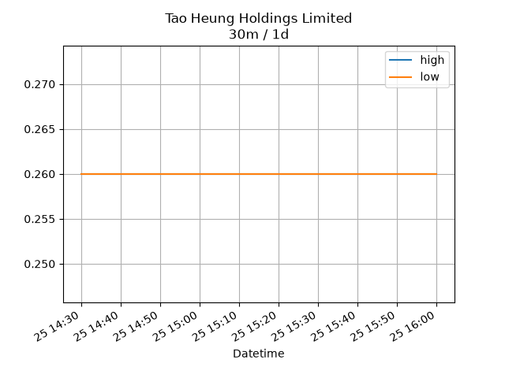|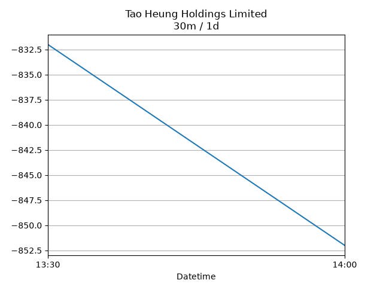|<table border="1" class="dataframe"> <thead> <tr style="text-align: center;"> <th>Datetime</th> <th>profit</th> </tr> </thead> <tbody> <tr> <td>13:30</td> <td>-832.0</td> </tr> <tr> <td>14:00</td> <td>-852.0</td> </tr> </tbody></table>|
||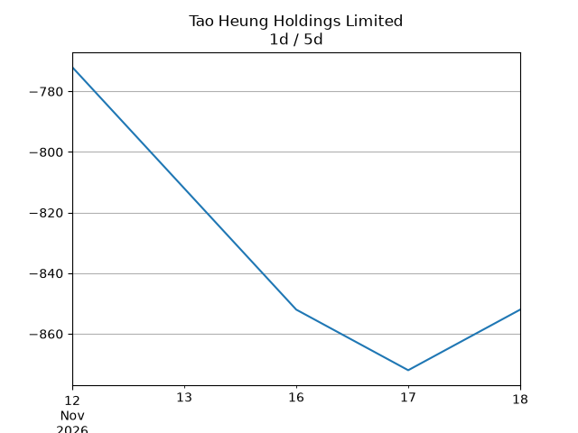|<table border="1" class="dataframe"> <thead> <tr style="text-align: center;"> <th>Date</th> <th>profit</th> </tr> </thead> <tbody> <tr> <td>2026-11-10</td> <td>-772.0</td> </tr> <tr> <td>2026-11-11</td> <td>-772.0</td> </tr> <tr> <td>2026-11-12</td> <td>-772.0</td> </tr> <tr> <td>2026-11-13</td> <td>-812.0</td> </tr> <tr> <td>2026-11-16</td> <td>-852.0</td> </tr> </tbody></table>|
|||<table border="1" class="dataframe"> <thead> <tr style="text-align: center;"> <th>Date</th> <th>profit</th> </tr> </thead> <tbody> <tr> <td>2026-10-12</td> <td>-792.0</td> </tr> <tr> <td>2026-10-19</td> <td>-792.0</td> </tr> <tr> <td>2026-10-26</td> <td>-752.0</td> </tr> <tr> <td>2026-11-02</td> <td>-792.0</td> </tr> <tr> <td>2026-11-09</td> <td>-812.0</td> </tr> <tr> <td>2026-11-16</td> <td>-812.0</td> </tr> </tbody></table>|
---
## 0560.HK [📉] [$-936.00] [-29.10%]:
#### Chu Kong Shipping Enterprises (Group) Company Limited
|price|profit|data|
|:---:|:---:|:---:|
|||<table border="1" class="dataframe"> <thead> <tr style="text-align: center;"> <th>Datetime</th> <th>profit</th> </tr> </thead> <tbody> <tr> <td>14:00</td> <td>-936.0</td> </tr> <tr> <td>15:00</td> <td>-936.0</td> </tr> </tbody></table>|
|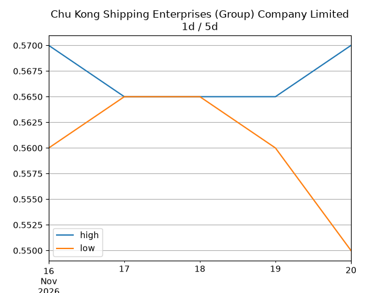|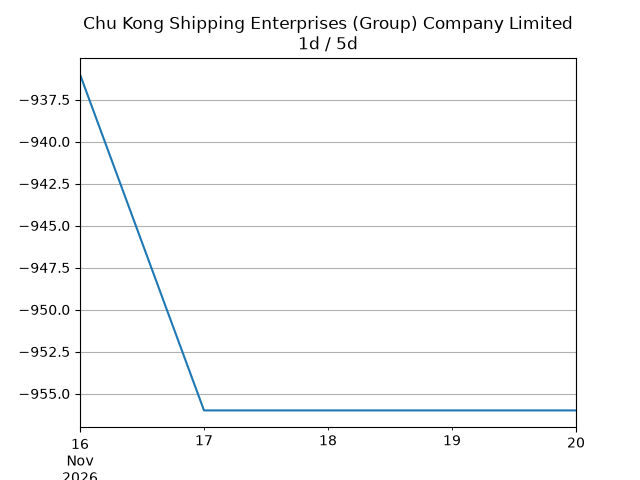|<table border="1" class="dataframe"> <thead> <tr style="text-align: center;"> <th>Date</th> <th>profit</th> </tr> </thead> <tbody> <tr> <td>2026-11-10</td> <td>-936.0</td> </tr> <tr> <td>2026-11-11</td> <td>-896.0</td> </tr> <tr> <td>2026-11-12</td> <td>-936.0</td> </tr> <tr> <td>2026-11-13</td> <td>-936.0</td> </tr> <tr> <td>2026-11-16</td> <td>-936.0</td> </tr> </tbody></table>|
||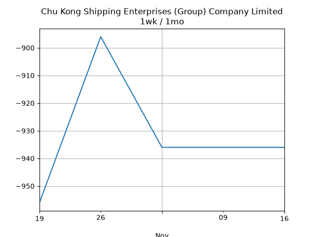|<table border="1" class="dataframe"> <thead> <tr style="text-align: center;"> <th>Date</th> <th>profit</th> </tr> </thead> <tbody> <tr> <td>2026-10-12</td> <td>-896.0</td> </tr> <tr> <td>2026-10-19</td> <td>-956.0</td> </tr> <tr> <td>2026-10-26</td> <td>-896.0</td> </tr> <tr> <td>2026-11-02</td> <td>-936.0</td> </tr> <tr> <td>2026-11-09</td> <td>-936.0</td> </tr> <tr> <td>2026-11-16</td> <td>-936.0</td> </tr> </tbody></table>|
---
## 0709.HK [📉] [$-1796.00] [-43.01%]:
#### Giordano International Limited
|price|profit|data|
|:---:|:---:|:---:|
|||<table border="1" class="dataframe"> <thead> <tr style="text-align: center;"> <th>Datetime</th> <th>profit</th> </tr> </thead> <tbody> <tr> <td>09:30</td> <td>-1776.0</td> </tr> <tr> <td>10:00</td> <td>-1756.0</td> </tr> <tr> <td>10:30</td> <td>-1756.0</td> </tr> <tr> <td>11:00</td> <td>-1786.0</td> </tr> <tr> <td>11:30</td> <td>-1786.0</td> </tr> <tr> <td>13:00</td> <td>-1786.0</td> </tr> <tr> <td>13:30</td> <td>-1786.0</td> </tr> <tr> <td>14:00</td> <td>-1796.0</td> </tr> <tr> <td>14:30</td> <td>-1796.0</td> </tr> <tr> <td>15:00</td> <td>-1796.0</td> </tr> <tr> <td>15:30</td> <td>-1796.0</td> </tr> </tbody></table>|
||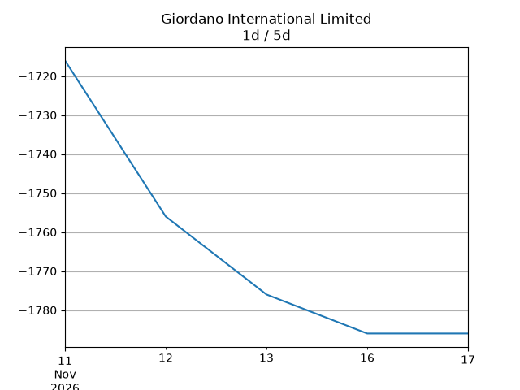|<table border="1" class="dataframe"> <thead> <tr style="text-align: center;"> <th>Date</th> <th>profit</th> </tr> </thead> <tbody> <tr> <td>2026-11-10</td> <td>-1716.0</td> </tr> <tr> <td>2026-11-11</td> <td>-1716.0</td> </tr> <tr> <td>2026-11-12</td> <td>-1756.0</td> </tr> <tr> <td>2026-11-13</td> <td>-1776.0</td> </tr> <tr> <td>2026-11-16</td> <td>-1796.0</td> </tr> </tbody></table>|
|||<table border="1" class="dataframe"> <thead> <tr style="text-align: center;"> <th>Date</th> <th>profit</th> </tr> </thead> <tbody> <tr> <td>2026-10-12</td> <td>-1556.0</td> </tr> <tr> <td>2026-10-19</td> <td>-1646.0</td> </tr> <tr> <td>2026-10-26</td> <td>-1686.0</td> </tr> <tr> <td>2026-11-02</td> <td>-1716.0</td> </tr> <tr> <td>2026-11-09</td> <td>-1776.0</td> </tr> <tr> <td>2026-11-16</td> <td>-1776.0</td> </tr> </tbody></table>|
---
## 1310.HK [📉] [$-344.00] [-11.78%]:
#### HKBN Ltd.
|price|profit|data|
|:---:|:---:|:---:|
|||<table border="1" class="dataframe"> <thead> <tr style="text-align: center;"> <th>Datetime</th> <th>profit</th> </tr> </thead> <tbody> <tr> <td>09:30</td> <td>-344.0</td> </tr> <tr> <td>10:00</td> <td>-331.5</td> </tr> <tr> <td>10:30</td> <td>-329.0</td> </tr> <tr> <td>11:00</td> <td>-341.5</td> </tr> <tr> <td>11:30</td> <td>-334.0</td> </tr> <tr> <td>13:00</td> <td>-324.0</td> </tr> <tr> <td>13:30</td> <td>-334.0</td> </tr> <tr> <td>14:00</td> <td>-334.0</td> </tr> <tr> <td>14:30</td> <td>-344.0</td> </tr> <tr> <td>15:00</td> <td>-346.5</td> </tr> <tr> <td>15:30</td> <td>-344.0</td> </tr> </tbody></table>|
|||<table border="1" class="dataframe"> <thead> <tr style="text-align: center;"> <th>Date</th> <th>profit</th> </tr> </thead> <tbody> <tr> <td>2026-11-10</td> <td>-221.5</td> </tr> <tr> <td>2026-11-11</td> <td>-229.0</td> </tr> <tr> <td>2026-11-12</td> <td>-279.0</td> </tr> <tr> <td>2026-11-13</td> <td>-321.5</td> </tr> <tr> <td>2026-11-16</td> <td>-344.0</td> </tr> </tbody></table>|
|||<table border="1" class="dataframe"> <thead> <tr style="text-align: center;"> <th>Date</th> <th>profit</th> </tr> </thead> <tbody> <tr> <td>2026-10-12</td> <td>-9.0</td> </tr> <tr> <td>2026-10-19</td> <td>-116.5</td> </tr> <tr> <td>2026-10-26</td> <td>-261.5</td> </tr> <tr> <td>2026-11-02</td> <td>-206.5</td> </tr> <tr> <td>2026-11-09</td> <td>-321.5</td> </tr> <tr> <td>2026-11-16</td> <td>-321.5</td> </tr> </tbody></table>|
---
## 2638.HK [📈] [$273.50] [9.60%]:
#### HK Electric Investments and HK Electric Investments Limited
|price|profit|data|
|:---:|:---:|:---:|
||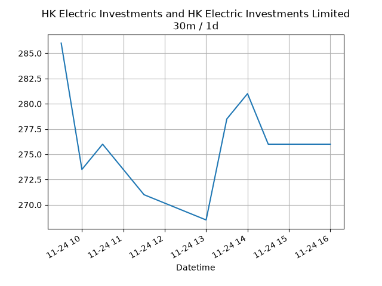|<table border="1" class="dataframe"> <thead> <tr style="text-align: center;"> <th>Datetime</th> <th>profit</th> </tr> </thead> <tbody> <tr> <td>09:30</td> <td>256.0</td> </tr> <tr> <td>10:00</td> <td>268.5</td> </tr> <tr> <td>10:30</td> <td>271.0</td> </tr> <tr> <td>11:00</td> <td>276.0</td> </tr> <tr> <td>11:30</td> <td>266.0</td> </tr> <tr> <td>13:00</td> <td>273.5</td> </tr> <tr> <td>13:30</td> <td>268.5</td> </tr> <tr> <td>14:00</td> <td>263.5</td> </tr> <tr> <td>14:30</td> <td>261.0</td> </tr> <tr> <td>15:00</td> <td>271.0</td> </tr> <tr> <td>15:30</td> <td>273.5</td> </tr> </tbody></table>|
|||<table border="1" class="dataframe"> <thead> <tr style="text-align: center;"> <th>Date</th> <th>profit</th> </tr> </thead> <tbody> <tr> <td>2026-11-10</td> <td>286.0</td> </tr> <tr> <td>2026-11-11</td> <td>273.5</td> </tr> <tr> <td>2026-11-12</td> <td>258.5</td> </tr> <tr> <td>2026-11-13</td> <td>251.0</td> </tr> <tr> <td>2026-11-16</td> <td>271.0</td> </tr> </tbody></table>|
|||<table border="1" class="dataframe"> <thead> <tr style="text-align: center;"> <th>Date</th> <th>profit</th> </tr> </thead> <tbody> <tr> <td>2026-10-12</td> <td>248.5</td> </tr> <tr> <td>2026-10-19</td> <td>261.0</td> </tr> <tr> <td>2026-10-26</td> <td>231.0</td> </tr> <tr> <td>2026-11-02</td> <td>253.5</td> </tr> <tr> <td>2026-11-09</td> <td>251.0</td> </tr> <tr> <td>2026-11-16</td> <td>251.0</td> </tr> </tbody></table>|
---
## 0533.HK [📉] [$-1725.00] [-43.40%]:
#### Goldlion Holdings Limited
|price|profit|data|
|:---:|:---:|:---:|
|||<table border="1" class="dataframe"> <thead> <tr style="text-align: center;"> <th>Datetime</th> <th>profit</th> </tr> </thead> <tbody> <tr> <td>10:00</td> <td>-1725.0</td> </tr> </tbody></table>|
||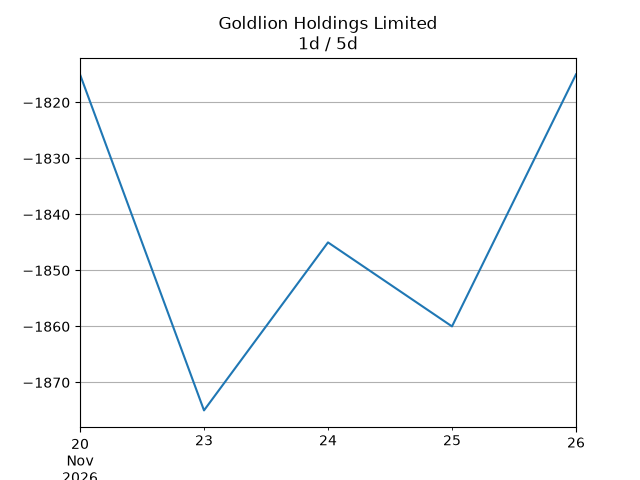|<table border="1" class="dataframe"> <thead> <tr style="text-align: center;"> <th>Date</th> <th>profit</th> </tr> </thead> <tbody> <tr> <td>2026-11-10</td> <td>-1725.0</td> </tr> <tr> <td>2026-11-11</td> <td>-1725.0</td> </tr> <tr> <td>2026-11-12</td> <td>-1650.0</td> </tr> <tr> <td>2026-11-13</td> <td>-1665.0</td> </tr> <tr> <td>2026-11-16</td> <td>-1725.0</td> </tr> </tbody></table>|
||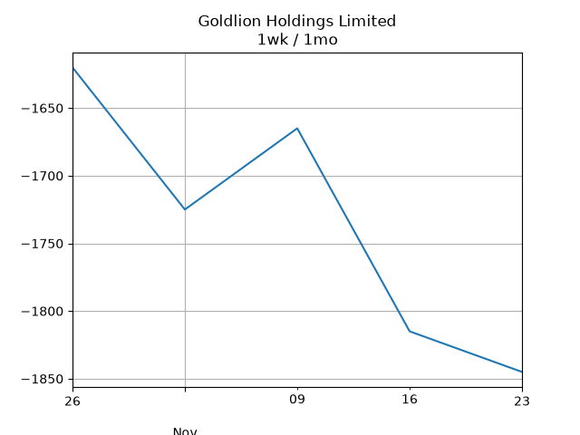|<table border="1" class="dataframe"> <thead> <tr style="text-align: center;"> <th>Date</th> <th>profit</th> </tr> </thead> <tbody> <tr> <td>2026-10-12</td> <td>-1590.0</td> </tr> <tr> <td>2026-10-19</td> <td>-1575.0</td> </tr> <tr> <td>2026-10-26</td> <td>-1620.0</td> </tr> <tr> <td>2026-11-02</td> <td>-1725.0</td> </tr> <tr> <td>2026-11-09</td> <td>-1665.0</td> </tr> <tr> <td>2026-11-16</td> <td>-1665.0</td> </tr> </tbody></table>|
---
## 2618.HK [📉] [$-366.00] [-26.33%]:
#### JD Logistics, Inc.
|price|profit|data|
|:---:|:---:|:---:|
|||<table border="1" class="dataframe"> <thead> <tr style="text-align: center;"> <th>Datetime</th> <th>profit</th> </tr> </thead> <tbody> <tr> <td>09:30</td> <td>-346.0</td> </tr> <tr> <td>10:00</td> <td>-347.0</td> </tr> <tr> <td>10:30</td> <td>-353.0</td> </tr> <tr> <td>11:00</td> <td>-355.0</td> </tr> <tr> <td>11:30</td> <td>-366.0</td> </tr> <tr> <td>13:00</td> <td>-363.0</td> </tr> <tr> <td>13:30</td> <td>-365.0</td> </tr> <tr> <td>14:00</td> <td>-366.0</td> </tr> <tr> <td>14:30</td> <td>-367.0</td> </tr> <tr> <td>15:00</td> <td>-369.0</td> </tr> <tr> <td>15:30</td> <td>-366.0</td> </tr> </tbody></table>|
|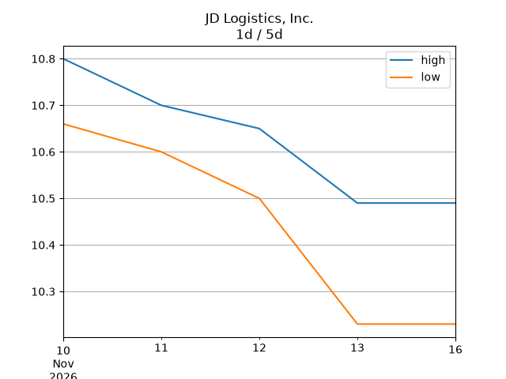||<table border="1" class="dataframe"> <thead> <tr style="text-align: center;"> <th>Date</th> <th>profit</th> </tr> </thead> <tbody> <tr> <td>2026-11-10</td> <td>-315.0</td> </tr> <tr> <td>2026-11-11</td> <td>-325.0</td> </tr> <tr> <td>2026-11-12</td> <td>-338.0</td> </tr> <tr> <td>2026-11-13</td> <td>-363.0</td> </tr> <tr> <td>2026-11-16</td> <td>-366.0</td> </tr> </tbody></table>|
|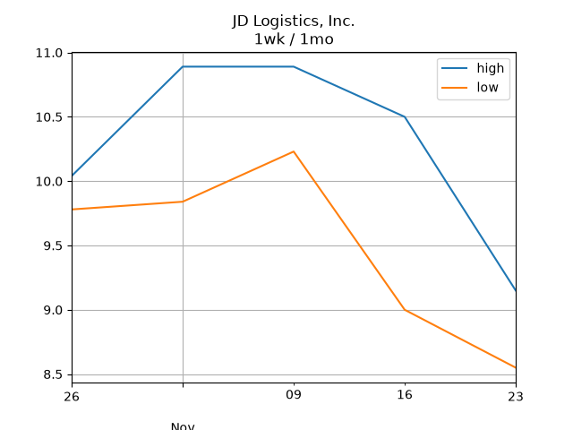||<table border="1" class="dataframe"> <thead> <tr style="text-align: center;"> <th>Date</th> <th>profit</th> </tr> </thead> <tbody> <tr> <td>2026-10-12</td> <td>-363.0</td> </tr> <tr> <td>2026-10-19</td> <td>-400.5</td> </tr> <tr> <td>2026-10-26</td> <td>-401.0</td> </tr> <tr> <td>2026-11-02</td> <td>-314.0</td> </tr> <tr> <td>2026-11-09</td> <td>-363.0</td> </tr> <tr> <td>2026-11-16</td> <td>-363.0</td> </tr> </tbody></table>|
---
