## Net Profit [📉]:
### $-5002.00
|type|graph|data|
|:---:|:---:|:---:|
|30m / 1d|||
|1d / 5d||<table border="1" class="dataframe"> <thead> <tr style="text-align: center;"> <th>Date</th> <th>profit</th> </tr> </thead> <tbody> <tr> <td>2026-11-13</td> <td>-5622.5</td> </tr> <tr> <td>2026-11-16</td> <td>-5726.0</td> </tr> <tr> <td>2026-11-17</td> <td>-5701.0</td> </tr> <tr> <td>2026-11-18</td> <td>-5692.5</td> </tr> <tr> <td>2026-11-19</td> <td>-5692.5</td> </tr> </tbody></table>|
|1wk / 1mo||<table border="1" class="dataframe"> <thead> <tr style="text-align: center;"> <th>Date</th> <th>profit</th> </tr> </thead> <tbody> <tr> <td>2026-10-19</td> <td>-5225.0</td> </tr> <tr> <td>2026-10-26</td> <td>-5385.5</td> </tr> <tr> <td>2026-11-02</td> <td>-5436.0</td> </tr> <tr> <td>2026-11-09</td> <td>-5622.5</td> </tr> <tr> <td>2026-11-16</td> <td>-5842.5</td> </tr> </tbody></table>|
---
## 0573.HK [📈] [$0.00] [0.00%]:
#### Tao Heung Holdings Limited
|price|profit|data|
|:---:|:---:|:---:|
|||<table border="1" class="dataframe"> <thead> <tr style="text-align: center;"> <th>index</th> <th>profit</th> </tr> </thead> <tbody> <tr> <td>00:00</td> <td>0</td> </tr> </tbody></table>|
|||<table border="1" class="dataframe"> <thead> <tr style="text-align: center;"> <th>Date</th> <th>profit</th> </tr> </thead> <tbody> <tr> <td>2026-11-13</td> <td>-812.0</td> </tr> <tr> <td>2026-11-16</td> <td>-852.0</td> </tr> <tr> <td>2026-11-17</td> <td>-872.0</td> </tr> <tr> <td>2026-11-18</td> <td>-852.0</td> </tr> </tbody></table>|
|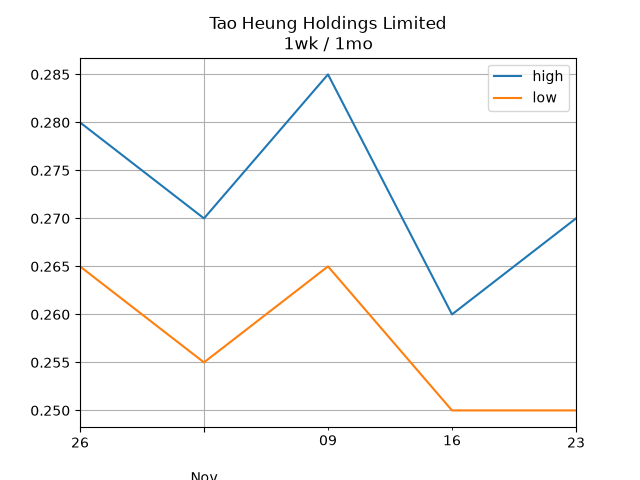|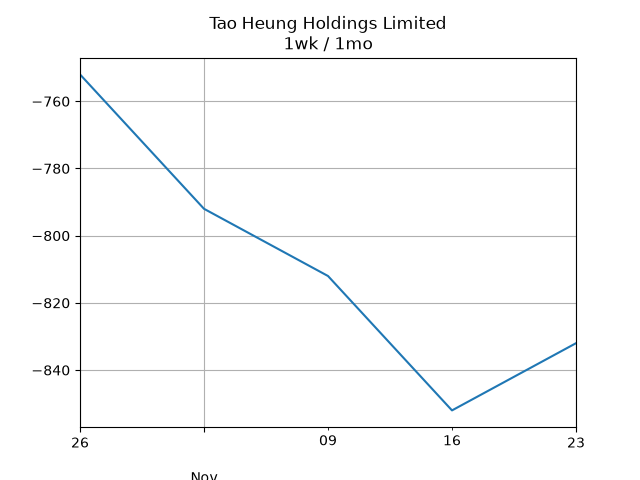|<table border="1" class="dataframe"> <thead> <tr style="text-align: center;"> <th>Date</th> <th>profit</th> </tr> </thead> <tbody> <tr> <td>2026-10-19</td> <td>-792.0</td> </tr> <tr> <td>2026-10-26</td> <td>-752.0</td> </tr> <tr> <td>2026-11-02</td> <td>-792.0</td> </tr> <tr> <td>2026-11-09</td> <td>-812.0</td> </tr> <tr> <td>2026-11-16</td> <td>-852.0</td> </tr> </tbody></table>|
---
## 0560.HK [📉] [$-976.00] [-30.35%]:
#### Chu Kong Shipping Enterprises (Group) Company Limited
|price|profit|data|
|:---:|:---:|:---:|
||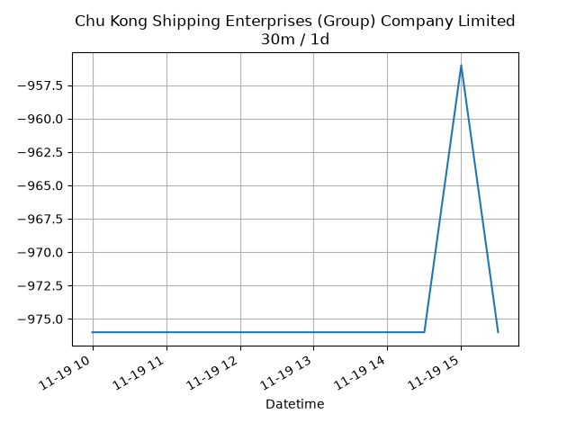|<table border="1" class="dataframe"> <thead> <tr style="text-align: center;"> <th>Datetime</th> <th>profit</th> </tr> </thead> <tbody> <tr> <td>10:00</td> <td>-976.0</td> </tr> <tr> <td>11:00</td> <td>-976.0</td> </tr> <tr> <td>13:30</td> <td>-976.0</td> </tr> <tr> <td>14:30</td> <td>-976.0</td> </tr> <tr> <td>15:00</td> <td>-956.0</td> </tr> <tr> <td>15:30</td> <td>-976.0</td> </tr> </tbody></table>|
|||<table border="1" class="dataframe"> <thead> <tr style="text-align: center;"> <th>Date</th> <th>profit</th> </tr> </thead> <tbody> <tr> <td>2026-11-13</td> <td>-936.0</td> </tr> <tr> <td>2026-11-16</td> <td>-936.0</td> </tr> <tr> <td>2026-11-17</td> <td>-956.0</td> </tr> <tr> <td>2026-11-18</td> <td>-956.0</td> </tr> <tr> <td>2026-11-19</td> <td>-956.0</td> </tr> </tbody></table>|
|||<table border="1" class="dataframe"> <thead> <tr style="text-align: center;"> <th>Date</th> <th>profit</th> </tr> </thead> <tbody> <tr> <td>2026-10-19</td> <td>-956.0</td> </tr> <tr> <td>2026-10-26</td> <td>-896.0</td> </tr> <tr> <td>2026-11-02</td> <td>-936.0</td> </tr> <tr> <td>2026-11-09</td> <td>-936.0</td> </tr> <tr> <td>2026-11-16</td> <td>-956.0</td> </tr> </tbody></table>|
---
## 0709.HK [📉] [$-1836.00] [-43.97%]:
#### Giordano International Limited
|price|profit|data|
|:---:|:---:|:---:|
|||<table border="1" class="dataframe"> <thead> <tr style="text-align: center;"> <th>Datetime</th> <th>profit</th> </tr> </thead> <tbody> <tr> <td>10:00</td> <td>-1806.0</td> </tr> <tr> <td>10:30</td> <td>-1816.0</td> </tr> <tr> <td>11:30</td> <td>-1806.0</td> </tr> <tr> <td>13:00</td> <td>-1816.0</td> </tr> <tr> <td>13:30</td> <td>-1806.0</td> </tr> <tr> <td>14:00</td> <td>-1826.0</td> </tr> <tr> <td>14:30</td> <td>-1856.0</td> </tr> <tr> <td>15:00</td> <td>-1846.0</td> </tr> <tr> <td>15:30</td> <td>-1836.0</td> </tr> <tr> <td>16:00</td> <td>-1836.0</td> </tr> </tbody></table>|
|||<table border="1" class="dataframe"> <thead> <tr style="text-align: center;"> <th>Date</th> <th>profit</th> </tr> </thead> <tbody> <tr> <td>2026-11-13</td> <td>-1776.0</td> </tr> <tr> <td>2026-11-16</td> <td>-1786.0</td> </tr> <tr> <td>2026-11-17</td> <td>-1786.0</td> </tr> <tr> <td>2026-11-18</td> <td>-1796.0</td> </tr> <tr> <td>2026-11-19</td> <td>-1836.0</td> </tr> </tbody></table>|
|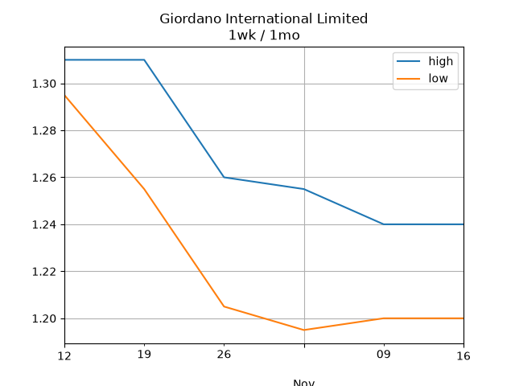||<table border="1" class="dataframe"> <thead> <tr style="text-align: center;"> <th>Date</th> <th>profit</th> </tr> </thead> <tbody> <tr> <td>2026-10-19</td> <td>-1646.0</td> </tr> <tr> <td>2026-10-26</td> <td>-1686.0</td> </tr> <tr> <td>2026-11-02</td> <td>-1716.0</td> </tr> <tr> <td>2026-11-09</td> <td>-1776.0</td> </tr> <tr> <td>2026-11-16</td> <td>-1836.0</td> </tr> </tbody></table>|
---
## 1310.HK [📉] [$-246.50] [-8.44%]:
#### HKBN Ltd.
|price|profit|data|
|:---:|:---:|:---:|
|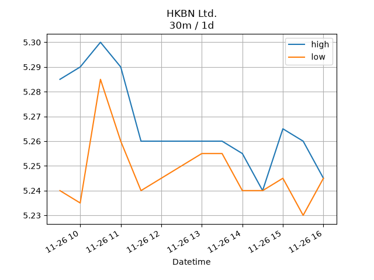||<table border="1" class="dataframe"> <thead> <tr style="text-align: center;"> <th>Datetime</th> <th>profit</th> </tr> </thead> <tbody> <tr> <td>09:30</td> <td>-259.0</td> </tr> <tr> <td>10:00</td> <td>-276.5</td> </tr> <tr> <td>10:30</td> <td>-281.5</td> </tr> <tr> <td>11:00</td> <td>-259.0</td> </tr> <tr> <td>11:30</td> <td>-254.0</td> </tr> <tr> <td>13:00</td> <td>-269.0</td> </tr> <tr> <td>13:30</td> <td>-266.5</td> </tr> <tr> <td>14:00</td> <td>-261.5</td> </tr> <tr> <td>14:30</td> <td>-266.5</td> </tr> <tr> <td>15:00</td> <td>-256.5</td> </tr> <tr> <td>15:30</td> <td>-246.5</td> </tr> </tbody></table>|
|||<table border="1" class="dataframe"> <thead> <tr style="text-align: center;"> <th>Date</th> <th>profit</th> </tr> </thead> <tbody> <tr> <td>2026-11-13</td> <td>-321.5</td> </tr> <tr> <td>2026-11-16</td> <td>-339.0</td> </tr> <tr> <td>2026-11-17</td> <td>-339.0</td> </tr> <tr> <td>2026-11-18</td> <td>-256.5</td> </tr> <tr> <td>2026-11-19</td> <td>-261.5</td> </tr> </tbody></table>|
|||<table border="1" class="dataframe"> <thead> <tr style="text-align: center;"> <th>Date</th> <th>profit</th> </tr> </thead> <tbody> <tr> <td>2026-10-19</td> <td>-116.5</td> </tr> <tr> <td>2026-10-26</td> <td>-261.5</td> </tr> <tr> <td>2026-11-02</td> <td>-206.5</td> </tr> <tr> <td>2026-11-09</td> <td>-321.5</td> </tr> <tr> <td>2026-11-16</td> <td>-261.5</td> </tr> </tbody></table>|
---
## 2638.HK [📈] [$278.50] [9.78%]:
#### HK Electric Investments and HK Electric Investments Limited
|price|profit|data|
|:---:|:---:|:---:|
|||<table border="1" class="dataframe"> <thead> <tr style="text-align: center;"> <th>Datetime</th> <th>profit</th> </tr> </thead> <tbody> <tr> <td>09:30</td> <td>273.5</td> </tr> <tr> <td>10:00</td> <td>278.5</td> </tr> <tr> <td>10:30</td> <td>276.0</td> </tr> <tr> <td>11:00</td> <td>273.5</td> </tr> <tr> <td>11:30</td> <td>273.5</td> </tr> <tr> <td>13:00</td> <td>273.5</td> </tr> <tr> <td>13:30</td> <td>276.0</td> </tr> <tr> <td>14:00</td> <td>276.0</td> </tr> <tr> <td>14:30</td> <td>276.0</td> </tr> <tr> <td>15:00</td> <td>276.0</td> </tr> <tr> <td>15:30</td> <td>278.5</td> </tr> </tbody></table>|
|||<table border="1" class="dataframe"> <thead> <tr style="text-align: center;"> <th>Date</th> <th>profit</th> </tr> </thead> <tbody> <tr> <td>2026-11-13</td> <td>251.0</td> </tr> <tr> <td>2026-11-16</td> <td>276.0</td> </tr> <tr> <td>2026-11-17</td> <td>286.0</td> </tr> <tr> <td>2026-11-18</td> <td>271.0</td> </tr> <tr> <td>2026-11-19</td> <td>286.0</td> </tr> </tbody></table>|
|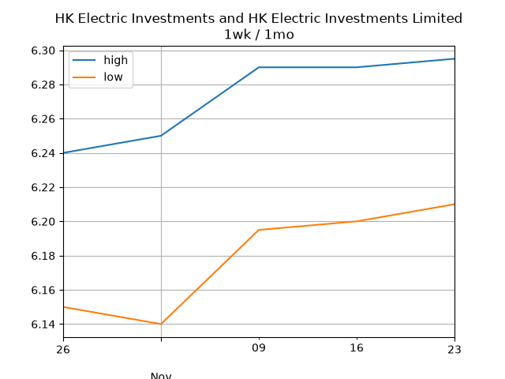|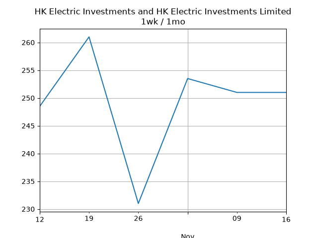|<table border="1" class="dataframe"> <thead> <tr style="text-align: center;"> <th>Date</th> <th>profit</th> </tr> </thead> <tbody> <tr> <td>2026-10-19</td> <td>261.0</td> </tr> <tr> <td>2026-10-26</td> <td>231.0</td> </tr> <tr> <td>2026-11-02</td> <td>253.5</td> </tr> <tr> <td>2026-11-09</td> <td>251.0</td> </tr> <tr> <td>2026-11-16</td> <td>286.0</td> </tr> </tbody></table>|
---
## 0533.HK [📉] [$-1785.00] [-44.91%]:
#### Goldlion Holdings Limited
|price|profit|data|
|:---:|:---:|:---:|
||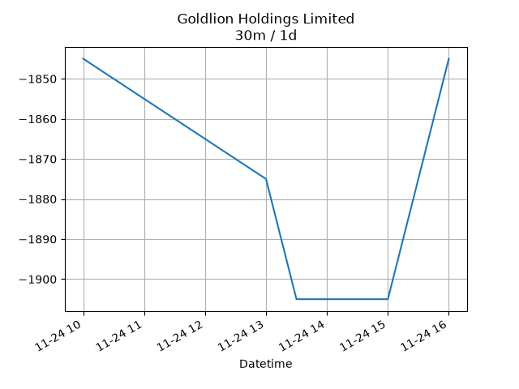|<table border="1" class="dataframe"> <thead> <tr style="text-align: center;"> <th>Datetime</th> <th>profit</th> </tr> </thead> <tbody> <tr> <td>09:30</td> <td>-1740.0</td> </tr> <tr> <td>11:00</td> <td>-1800.0</td> </tr> <tr> <td>11:30</td> <td>-1785.0</td> </tr> <tr> <td>13:00</td> <td>-1785.0</td> </tr> <tr> <td>13:30</td> <td>-1785.0</td> </tr> <tr> <td>15:30</td> <td>-1785.0</td> </tr> </tbody></table>|
|||<table border="1" class="dataframe"> <thead> <tr style="text-align: center;"> <th>Date</th> <th>profit</th> </tr> </thead> <tbody> <tr> <td>2026-11-13</td> <td>-1665.0</td> </tr> <tr> <td>2026-11-16</td> <td>-1725.0</td> </tr> <tr> <td>2026-11-17</td> <td>-1665.0</td> </tr> <tr> <td>2026-11-18</td> <td>-1710.0</td> </tr> <tr> <td>2026-11-19</td> <td>-1785.0</td> </tr> </tbody></table>|
|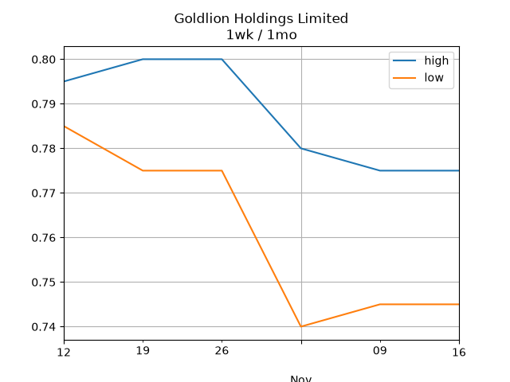||<table border="1" class="dataframe"> <thead> <tr style="text-align: center;"> <th>Date</th> <th>profit</th> </tr> </thead> <tbody> <tr> <td>2026-10-19</td> <td>-1575.0</td> </tr> <tr> <td>2026-10-26</td> <td>-1620.0</td> </tr> <tr> <td>2026-11-02</td> <td>-1725.0</td> </tr> <tr> <td>2026-11-09</td> <td>-1665.0</td> </tr> <tr> <td>2026-11-16</td> <td>-1785.0</td> </tr> </tbody></table>|
---
## 2618.HK [📉] [$-437.00] [-31.44%]:
#### JD Logistics, Inc.
|price|profit|data|
|:---:|:---:|:---:|
|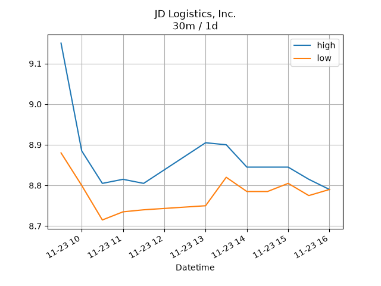|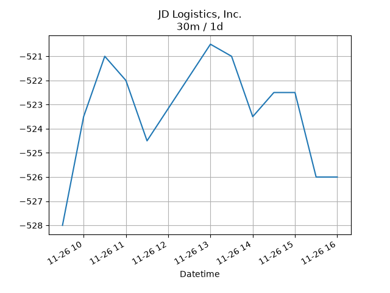|<table border="1" class="dataframe"> <thead> <tr style="text-align: center;"> <th>Datetime</th> <th>profit</th> </tr> </thead> <tbody> <tr> <td>09:30</td> <td>-421.5</td> </tr> <tr> <td>10:00</td> <td>-426.0</td> </tr> <tr> <td>10:30</td> <td>-432.5</td> </tr> <tr> <td>11:00</td> <td>-428.0</td> </tr> <tr> <td>11:30</td> <td>-426.5</td> </tr> <tr> <td>13:00</td> <td>-437.0</td> </tr> <tr> <td>13:30</td> <td>-442.0</td> </tr> <tr> <td>14:00</td> <td>-435.5</td> </tr> <tr> <td>14:30</td> <td>-436.5</td> </tr> <tr> <td>15:00</td> <td>-434.0</td> </tr> <tr> <td>15:30</td> <td>-437.0</td> </tr> </tbody></table>|
|||<table border="1" class="dataframe"> <thead> <tr style="text-align: center;"> <th>Date</th> <th>profit</th> </tr> </thead> <tbody> <tr> <td>2026-11-13</td> <td>-363.0</td> </tr> <tr> <td>2026-11-16</td> <td>-364.0</td> </tr> <tr> <td>2026-11-17</td> <td>-369.0</td> </tr> <tr> <td>2026-11-18</td> <td>-393.0</td> </tr> <tr> <td>2026-11-19</td> <td>-438.0</td> </tr> </tbody></table>|
||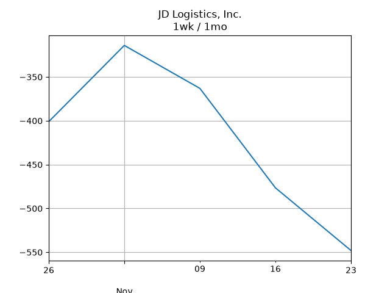|<table border="1" class="dataframe"> <thead> <tr style="text-align: center;"> <th>Date</th> <th>profit</th> </tr> </thead> <tbody> <tr> <td>2026-10-19</td> <td>-400.5</td> </tr> <tr> <td>2026-10-26</td> <td>-401.0</td> </tr> <tr> <td>2026-11-02</td> <td>-314.0</td> </tr> <tr> <td>2026-11-09</td> <td>-363.0</td> </tr> <tr> <td>2026-11-16</td> <td>-438.0</td> </tr> </tbody></table>|
---
