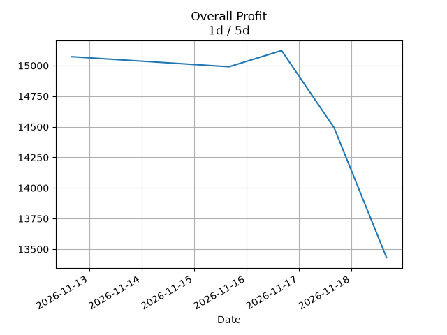
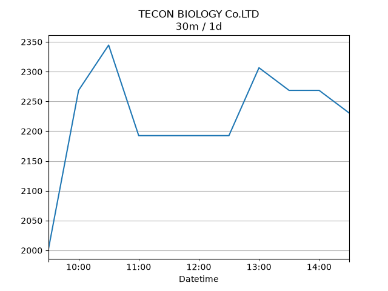
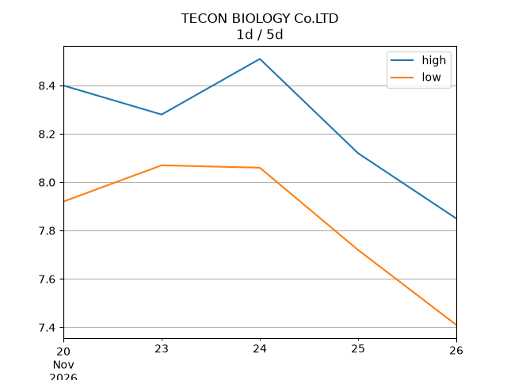
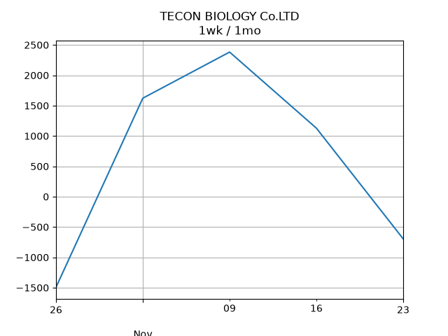
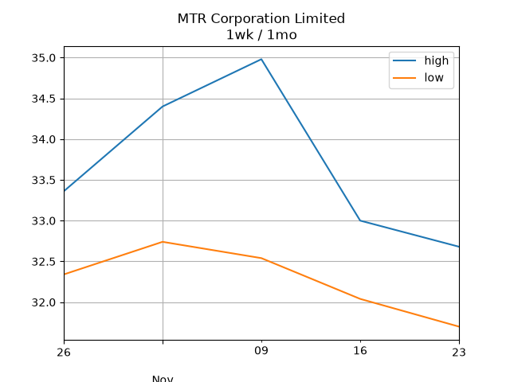

## Net Profit [📈]:
### $10800.60
|type|graph|data|
|:---:|:---:|:---:|
|30m / 1d||<table border="1" class="dataframe"> <thead> <tr style="text-align: center;"> <th>Datetime</th> <th>profit</th> </tr> </thead> <tbody> <tr> <td>01:30</td> <td>10370.6</td> </tr> <tr> <td>02:00</td> <td>10120.6</td> </tr> <tr> <td>02:30</td> <td>10280.6</td> </tr> <tr> <td>03:00</td> <td>10096.6</td> </tr> <tr> <td>03:30</td> <td>10066.6</td> </tr> <tr> <td>04:00</td> <td>10066.6</td> </tr> <tr> <td>04:30</td> <td>10066.6</td> </tr> <tr> <td>05:00</td> <td>10626.6</td> </tr> <tr> <td>05:30</td> <td>10634.6</td> </tr> <tr> <td>06:00</td> <td>10384.6</td> </tr> <tr> <td>06:30</td> <td>10710.6</td> </tr> <tr> <td>07:00</td> <td>10710.6</td> </tr> <tr> <td>07:30</td> <td>10710.6</td> </tr> <tr> <td>08:00</td> <td>10710.6</td> </tr> </tbody></table>|
|1d / 5d||<table border="1" class="dataframe"> <thead> <tr style="text-align: center;"> <th>Date</th> <th>profit</th> </tr> </thead> <tbody> <tr> <td>2026-11-22</td> <td>12818.6</td> </tr> <tr> <td>2026-11-23</td> <td>12122.6</td> </tr> <tr> <td>2026-11-24</td> <td>10974.6</td> </tr> <tr> <td>2026-11-25</td> <td>10540.6</td> </tr> <tr> <td>2026-11-26</td> <td>10838.6</td> </tr> </tbody></table>|
|1wk / 1mo||<table border="1" class="dataframe"> <thead> <tr style="text-align: center;"> <th>Date</th> <th>profit</th> </tr> </thead> <tbody> <tr> <td>2026-10-25</td> <td>12336.6</td> </tr> <tr> <td>2026-11-01</td> <td>16922.6</td> </tr> <tr> <td>2026-11-08</td> <td>15072.6</td> </tr> <tr> <td>2026-11-15</td> <td>13458.6</td> </tr> <tr> <td>2026-11-22</td> <td>10838.6</td> </tr> </tbody></table>|
---
## 002100.SZ [📉] [$-1379.40] [-4.56%]:
#### TECON BIOLOGY Co.LTD
|price|profit|data|
|:---:|:---:|:---:|
|||<table border="1" class="dataframe"> <thead> <tr style="text-align: center;"> <th>Datetime</th> <th>profit</th> </tr> </thead> <tbody> <tr> <td>09:30</td> <td>-1569.4</td> </tr> <tr> <td>10:00</td> <td>-1759.4</td> </tr> <tr> <td>10:30</td> <td>-1569.4</td> </tr> <tr> <td>11:00</td> <td>-1873.4</td> </tr> <tr> <td>11:30</td> <td>-1873.4</td> </tr> <tr> <td>12:00</td> <td>-1873.4</td> </tr> <tr> <td>12:30</td> <td>-1873.4</td> </tr> <tr> <td>13:00</td> <td>-1493.4</td> </tr> <tr> <td>13:30</td> <td>-1455.4</td> </tr> <tr> <td>14:00</td> <td>-1645.4</td> </tr> <tr> <td>14:30</td> <td>-1379.4</td> </tr> </tbody></table>|
|||<table border="1" class="dataframe"> <thead> <tr style="text-align: center;"> <th>Date</th> <th>profit</th> </tr> </thead> <tbody> <tr> <td>2026-11-23</td> <td>938.6</td> </tr> <tr> <td>2026-11-24</td> <td>482.6</td> </tr> <tr> <td>2026-11-25</td> <td>-695.4</td> </tr> <tr> <td>2026-11-26</td> <td>-1759.4</td> </tr> <tr> <td>2026-11-27</td> <td>-1341.4</td> </tr> </tbody></table>|
|||<table border="1" class="dataframe"> <thead> <tr style="text-align: center;"> <th>Date</th> <th>profit</th> </tr> </thead> <tbody> <tr> <td>2026-10-26</td> <td>-1493.4</td> </tr> <tr> <td>2026-11-02</td> <td>1622.6</td> </tr> <tr> <td>2026-11-09</td> <td>2382.6</td> </tr> <tr> <td>2026-11-16</td> <td>1128.6</td> </tr> <tr> <td>2026-11-23</td> <td>-1341.4</td> </tr> </tbody></table>|
---
## 0066.HK [📈] [$12180.00] [33.69%]:
#### MTR Corporation Limited
|price|profit|data|
|:---:|:---:|:---:|
|||<table border="1" class="dataframe"> <thead> <tr style="text-align: center;"> <th>Datetime</th> <th>profit</th> </tr> </thead> <tbody> <tr> <td>09:30</td> <td>11940.0</td> </tr> <tr> <td>10:00</td> <td>11880.0</td> </tr> <tr> <td>10:30</td> <td>11850.0</td> </tr> <tr> <td>11:00</td> <td>11970.0</td> </tr> <tr> <td>11:30</td> <td>11940.0</td> </tr> <tr> <td>13:00</td> <td>12120.0</td> </tr> <tr> <td>13:30</td> <td>12090.0</td> </tr> <tr> <td>14:00</td> <td>12030.0</td> </tr> <tr> <td>14:30</td> <td>12090.0</td> </tr> <tr> <td>15:00</td> <td>12060.0</td> </tr> <tr> <td>15:30</td> <td>12180.0</td> </tr> <tr> <td>16:00</td> <td>12180.0</td> </tr> </tbody></table>|
|||<table border="1" class="dataframe"> <thead> <tr style="text-align: center;"> <th>Date</th> <th>profit</th> </tr> </thead> <tbody> <tr> <td>2026-11-23</td> <td>11880.0</td> </tr> <tr> <td>2026-11-24</td> <td>11640.0</td> </tr> <tr> <td>2026-11-25</td> <td>11670.0</td> </tr> <tr> <td>2026-11-26</td> <td>12300.0</td> </tr> <tr> <td>2026-11-27</td> <td>12180.0</td> </tr> </tbody></table>|
|||<table border="1" class="dataframe"> <thead> <tr style="text-align: center;"> <th>Date</th> <th>profit</th> </tr> </thead> <tbody> <tr> <td>2026-10-26</td> <td>13830.0</td> </tr> <tr> <td>2026-11-02</td> <td>15300.0</td> </tr> <tr> <td>2026-11-09</td> <td>12690.0</td> </tr> <tr> <td>2026-11-16</td> <td>12330.0</td> </tr> <tr> <td>2026-11-23</td> <td>12180.0</td> </tr> </tbody></table>|
---
