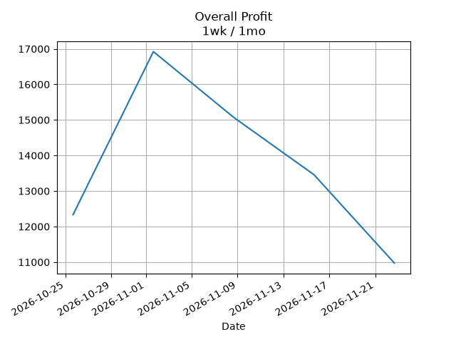
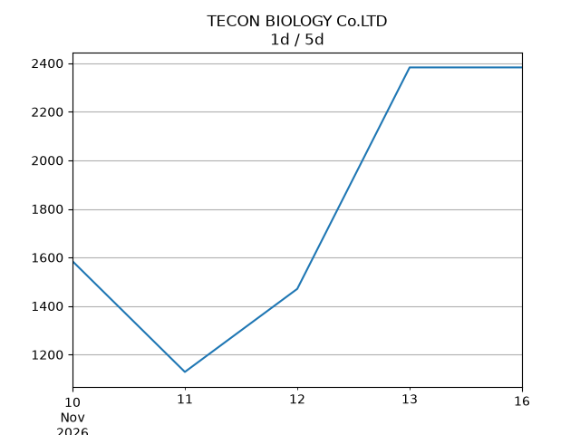
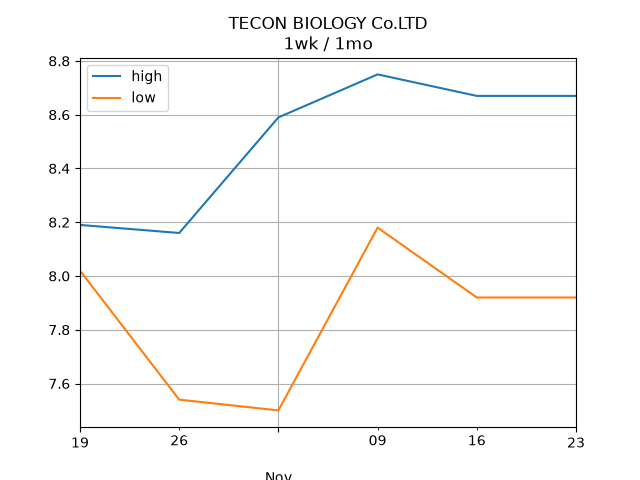
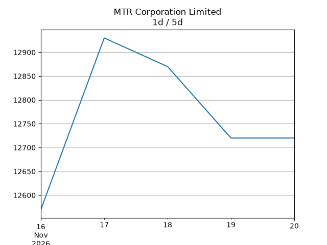
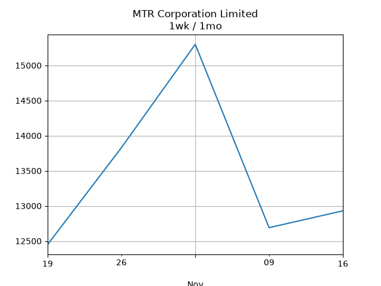

## Net Profit [📈]:
### $13392.60
|type|graph|data|
|:---:|:---:|:---:|
|30m / 1d||<table border="1" class="dataframe"> <thead> <tr style="text-align: center;"> <th>Datetime</th> <th>profit</th> </tr> </thead> <tbody> <tr> <td>01:30</td> <td>14036.6</td> </tr> <tr> <td>02:00</td> <td>13802.6</td> </tr> <tr> <td>02:30</td> <td>13568.6</td> </tr> <tr> <td>03:00</td> <td>13546.6</td> </tr> <tr> <td>03:30</td> <td>13478.6</td> </tr> <tr> <td>04:00</td> <td>13478.6</td> </tr> <tr> <td>04:30</td> <td>13478.6</td> </tr> <tr> <td>05:00</td> <td>13500.6</td> </tr> <tr> <td>05:30</td> <td>13302.6</td> </tr> <tr> <td>06:00</td> <td>13324.6</td> </tr> <tr> <td>06:30</td> <td>13422.6</td> </tr> <tr> <td>07:00</td> <td>13422.6</td> </tr> <tr> <td>07:30</td> <td>13422.6</td> </tr> </tbody></table>|
|1d / 5d||<table border="1" class="dataframe"> <thead> <tr style="text-align: center;"> <th>Date</th> <th>profit</th> </tr> </thead> <tbody> <tr> <td>2026-11-12</td> <td>15072.6</td> </tr> <tr> <td>2026-11-15</td> <td>14990.6</td> </tr> <tr> <td>2026-11-16</td> <td>15122.6</td> </tr> <tr> <td>2026-11-17</td> <td>14492.6</td> </tr> <tr> <td>2026-11-18</td> <td>13430.6</td> </tr> </tbody></table>|
|1wk / 1mo||<table border="1" class="dataframe"> <thead> <tr style="text-align: center;"> <th>Date</th> <th>profit</th> </tr> </thead> <tbody> <tr> <td>2026-10-18</td> <td>12856.6</td> </tr> <tr> <td>2026-10-25</td> <td>12336.6</td> </tr> <tr> <td>2026-11-01</td> <td>16922.6</td> </tr> <tr> <td>2026-11-08</td> <td>15072.6</td> </tr> <tr> <td>2026-11-15</td> <td>13430.6</td> </tr> </tbody></table>|
---
## 002100.SZ [📈] [$672.60] [2.22%]:
#### TECON BIOLOGY Co.LTD
|price|profit|data|
|:---:|:---:|:---:|
|||<table border="1" class="dataframe"> <thead> <tr style="text-align: center;"> <th>Datetime</th> <th>profit</th> </tr> </thead> <tbody> <tr> <td>09:30</td> <td>1166.6</td> </tr> <tr> <td>10:00</td> <td>1052.6</td> </tr> <tr> <td>10:30</td> <td>938.6</td> </tr> <tr> <td>11:00</td> <td>976.6</td> </tr> <tr> <td>11:30</td> <td>938.6</td> </tr> <tr> <td>12:00</td> <td>938.6</td> </tr> <tr> <td>12:30</td> <td>938.6</td> </tr> <tr> <td>13:00</td> <td>900.6</td> </tr> <tr> <td>13:30</td> <td>672.6</td> </tr> <tr> <td>14:00</td> <td>634.6</td> </tr> <tr> <td>14:30</td> <td>672.6</td> </tr> </tbody></table>|
|||<table border="1" class="dataframe"> <thead> <tr style="text-align: center;"> <th>Date</th> <th>profit</th> </tr> </thead> <tbody> <tr> <td>2026-11-13</td> <td>2382.6</td> </tr> <tr> <td>2026-11-16</td> <td>2420.6</td> </tr> <tr> <td>2026-11-17</td> <td>2192.6</td> </tr> <tr> <td>2026-11-18</td> <td>1622.6</td> </tr> <tr> <td>2026-11-19</td> <td>710.6</td> </tr> </tbody></table>|
|||<table border="1" class="dataframe"> <thead> <tr style="text-align: center;"> <th>Date</th> <th>profit</th> </tr> </thead> <tbody> <tr> <td>2026-10-19</td> <td>406.6</td> </tr> <tr> <td>2026-10-26</td> <td>-1493.4</td> </tr> <tr> <td>2026-11-02</td> <td>1622.6</td> </tr> <tr> <td>2026-11-09</td> <td>2382.6</td> </tr> <tr> <td>2026-11-16</td> <td>710.6</td> </tr> </tbody></table>|
---
## 0066.HK [📈] [$12720.00] [35.19%]:
#### MTR Corporation Limited
|price|profit|data|
|:---:|:---:|:---:|
|||<table border="1" class="dataframe"> <thead> <tr style="text-align: center;"> <th>Datetime</th> <th>profit</th> </tr> </thead> <tbody> <tr> <td>09:30</td> <td>12870.0</td> </tr> <tr> <td>10:00</td> <td>12750.0</td> </tr> <tr> <td>10:30</td> <td>12630.0</td> </tr> <tr> <td>11:00</td> <td>12570.0</td> </tr> <tr> <td>11:30</td> <td>12540.0</td> </tr> <tr> <td>13:00</td> <td>12600.0</td> </tr> <tr> <td>13:30</td> <td>12630.0</td> </tr> <tr> <td>14:00</td> <td>12690.0</td> </tr> <tr> <td>14:30</td> <td>12750.0</td> </tr> <tr> <td>15:00</td> <td>12720.0</td> </tr> <tr> <td>15:30</td> <td>12720.0</td> </tr> </tbody></table>|
|||<table border="1" class="dataframe"> <thead> <tr style="text-align: center;"> <th>Date</th> <th>profit</th> </tr> </thead> <tbody> <tr> <td>2026-11-13</td> <td>12690.0</td> </tr> <tr> <td>2026-11-16</td> <td>12570.0</td> </tr> <tr> <td>2026-11-17</td> <td>12930.0</td> </tr> <tr> <td>2026-11-18</td> <td>12870.0</td> </tr> <tr> <td>2026-11-19</td> <td>12720.0</td> </tr> </tbody></table>|
|||<table border="1" class="dataframe"> <thead> <tr style="text-align: center;"> <th>Date</th> <th>profit</th> </tr> </thead> <tbody> <tr> <td>2026-10-19</td> <td>12450.0</td> </tr> <tr> <td>2026-10-26</td> <td>13830.0</td> </tr> <tr> <td>2026-11-02</td> <td>15300.0</td> </tr> <tr> <td>2026-11-09</td> <td>12690.0</td> </tr> <tr> <td>2026-11-16</td> <td>12720.0</td> </tr> </tbody></table>|
---
